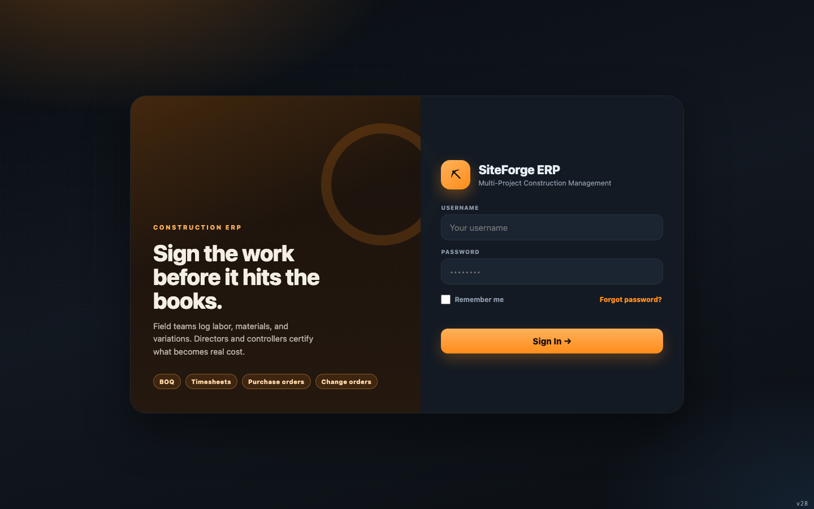

# SiteForge ERP — Role Guides

Step-by-step guides for each role, from sign-in to end of day, with screenshots.

| Role | One-line duty | Guide |
|---|---|---|
| **Project Director** | Full oversight — approve/certify everything, manage users, review audit | [director.md](director.md) |
| **Financial Controller** | Money — approvals within limits, AR/AP, payroll, retention, payables | [controller.md](controller.md) |
| **Field Superintendent** | Field data — daily reports, timesheets, POs, change orders, receiving | [field-superintendent.md](field-superintendent.md) |
| **Tradesperson Lead** | Narrow — log own time, view drawings/timeline, submit site reports | [tradesperson-lead.md](tradesperson-lead.md) |

## How the app is organised

The left sidebar is split into **COMPANY** (whole business) and **PROJECT** (one selected project,
chosen from the selector in the top bar). The **SYSTEM** section holds Settings/Users/History.
Each guide shows which of these you can see.

## Where the screenshots live

`docs/screenshots/guides/<role>/` — one PNG per screen. They are captured from the real app
(signed in as that role against sample data), so what you see on screen will match these images
after your own data is loaded.

## Shared basics (every role)

1. **Sign in** — username + password on the login screen.
   
2. **Notifications** — the 🔔 button shows compliance alerts, budget alerts and system messages.
   Dismiss individual items with ✕ or **Mark all read**.
3. **Theme/language** — ⚙ Settings → Appearance → dark/light, font, size, and English/العربية.
4. **Select a project** — the dropdown in the top bar; PROJECT views only appear after you pick one.

## Approval concepts (who can decide what)

- Only **Directors** and **Controllers** can approve/reject.
- **Segregation of duties**: you cannot approve something you submitted yourself.
- **Limits of authority**: Directors are unlimited; Controllers are capped per table (default
  AED 100k) and Field Superintendents are capped (AED 25k) — an over-limit item is refused.
- **Evidence**: above a per-table threshold an approval needs an attached document first (📎).
- Every decision is written to an immutable audit log (🕓 timeline).

Continue to your role's guide for the full day-by-day walkthrough.
