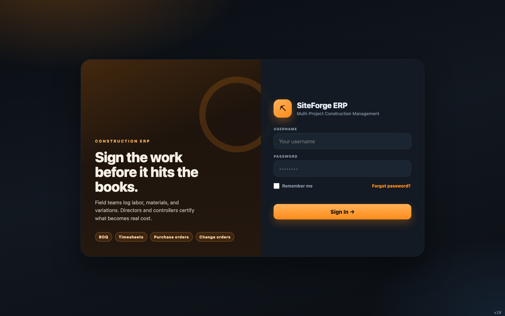

# أدلة الأدوار — SiteForge ERP

أدلة خطوة بخطوة لكل دور، من تسجيل الدخول حتى نهاية يوم العمل، مع لقطات شاشة.

| الدور | المهمة باختصار | الدليل |
|---|---|---|
| **مدير المشروع** | إشراف كامل — اعتماد كل شيء، إدارة المستخدمين، مراجعة السجل | [director.md](director.md) |
| **المراقب المالي** | المال — اعتمادات ضمن الحدود، الذمم المدينة/الدائنة، الرواتب، المستحقات المحتجزة | [controller.md](controller.md) |
| **مهندس الموقع** | بيانات الموقع — التقارير اليومية، الحضور، أوامر الشراء، أوامر التغيير، الاستلام | [field-superintendent.md](field-superintendent.md) |
| **رئيس العمال (فورمان)** | نطاق محدود — تسجيل ساعات عمله، الاطلاع على المخططات والجدول، تقارير الموقع | [tradesperson-lead.md](tradesperson-lead.md) |

## تنظيم التطبيق

تنقسم القائمة الجانبية إلى **الشركة** (كل الأعمال) و**المشروع** (مشروع واحد محدد من القائمة
العلوية). ويضم قسم **النظام** الإعدادات/المستخدمين/السجل. يوضح كل دليل ما يمكنك رؤيته من هذه الأقسام.

## مكان لقطات الشاشة

`docs/screenshots/guides/<role>/` — صورة لكل شاشة، ملتقطة من التطبيق الفعلي بعد تسجيل الدخول
بكل دور.

## الأساسيات المشتركة (لكل الأدوار)

1. **تسجيل الدخول** — اسم المستخدم وكلمة المرور.
   
2. **الإشعارات** — زر 🔔 يعرض تنبيهات الامتثال والميزانية ورسائل النظام. أغلق أي عنصر بزر ✕ أو
   **تعليم الكل كمقروء**.
3. **المظهر/اللغة** — ⚙ الإعدادات → المظهر → داكن/فاتح، الخط، الحجم، والعربية/English.
4. **اختيار المشروع** — القائمة المنسدلة في الشريط العلوي؛ لا تظهر أقسام المشروع إلا بعد اختياره.

## مفاهيم الاعتماد (من يقرر ماذا)

- المدير والمراقب المالي فقط من يمكنهما الاعتماد/الرفض.
- **فصل المهام**: لا يمكنك اعتماد ما قدمته بنفسك.
- **حدود الصلاحية**: المدير بلا حد، والمراقب المالي محدد بحد أقصى لكل جدول (افتراضيًا 100,000 درهم)،
  ومهندس الموقع محدد (25,000 درهم) — وأي عنصر يتجاوز الحد يُرفض.
- **المستندات**: فوق حد معين لكل جدول يتطلب الاعتماد إرفاق مستند أولًا (📎).
- كل قرار يُسجل في سجل غير قابل للتعديل (🕓 التسلسل الزمني).

تابع دليل دورك للمرور الكامل على يوم العمل.
