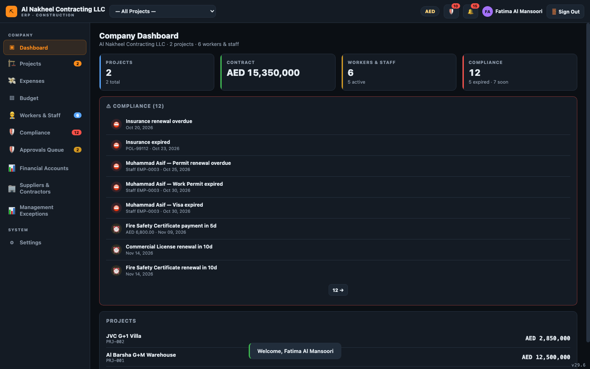
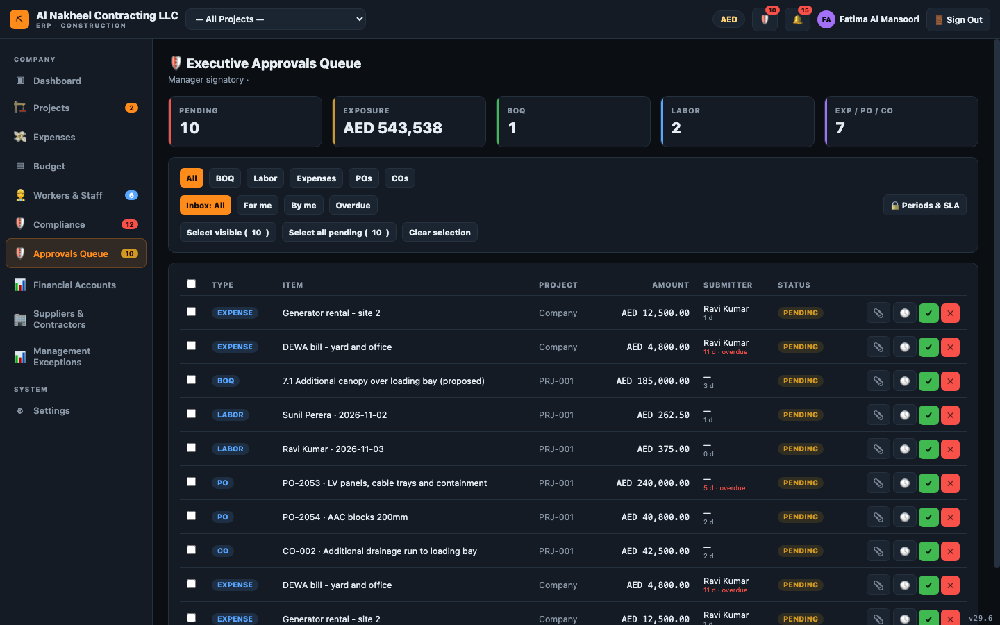
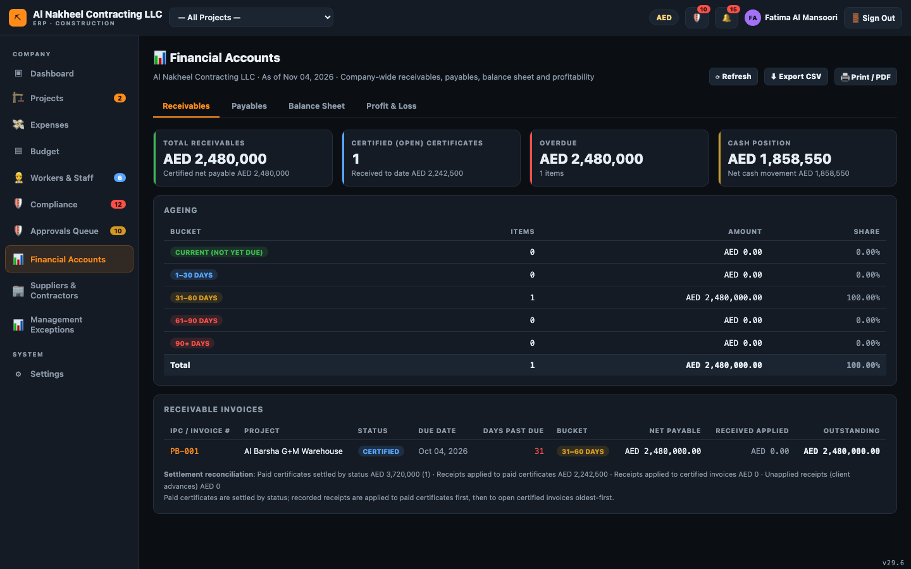
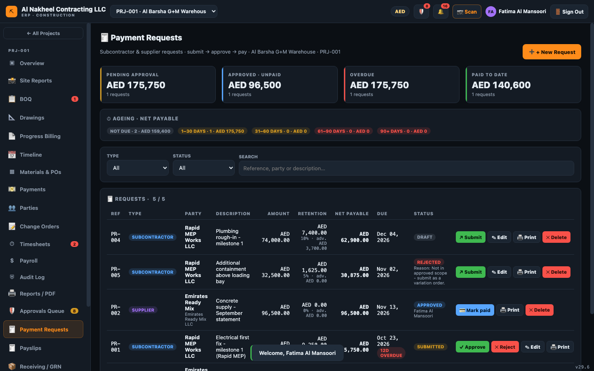
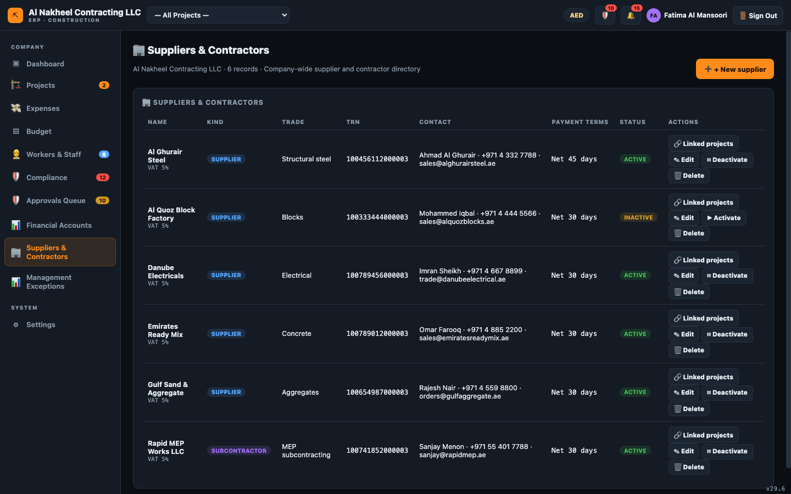
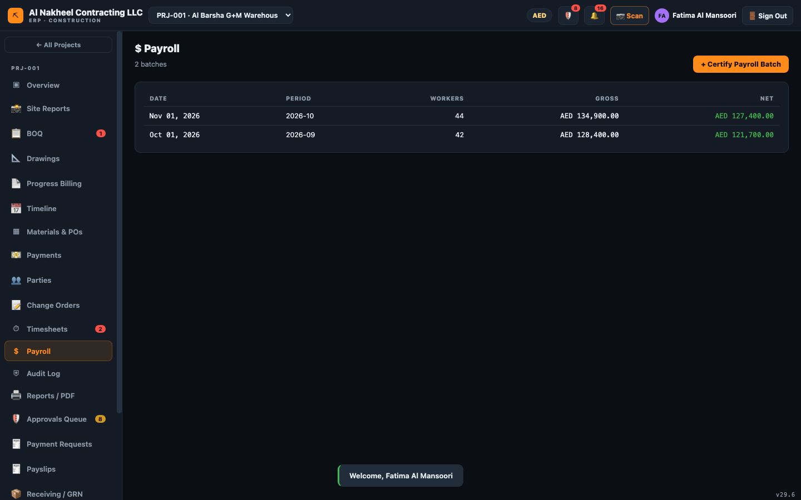
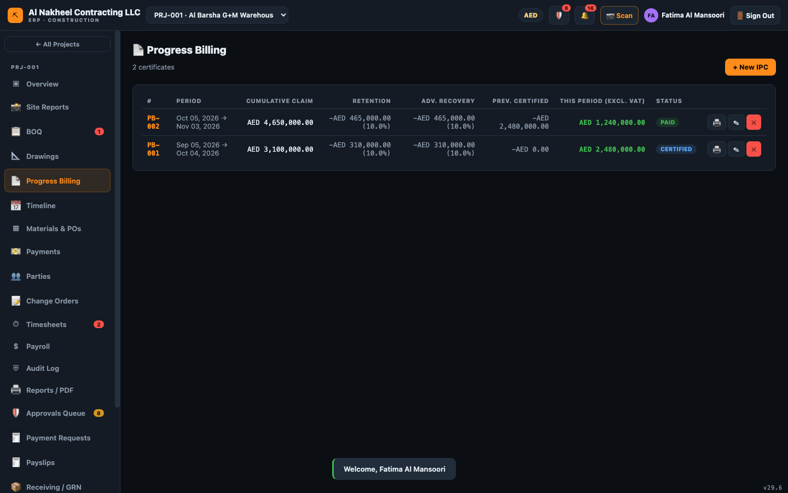
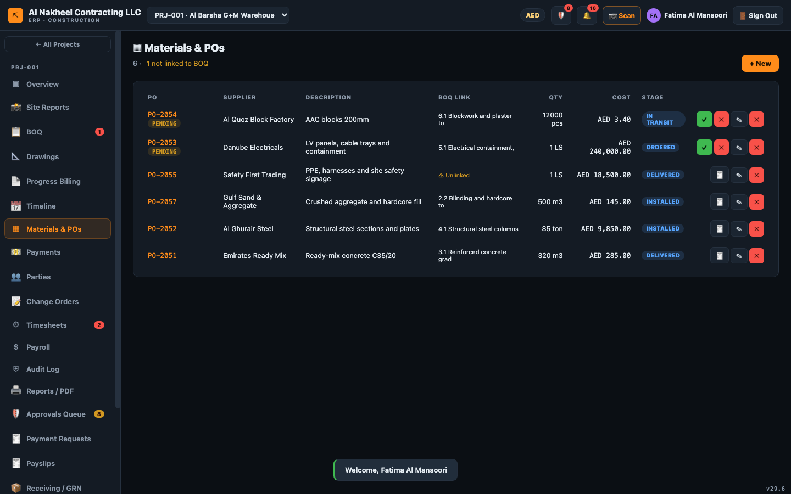
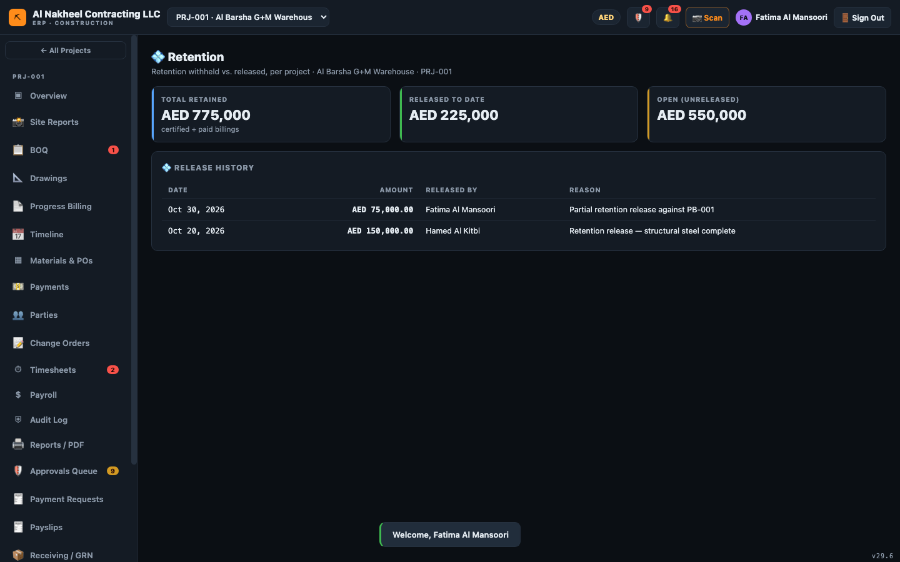
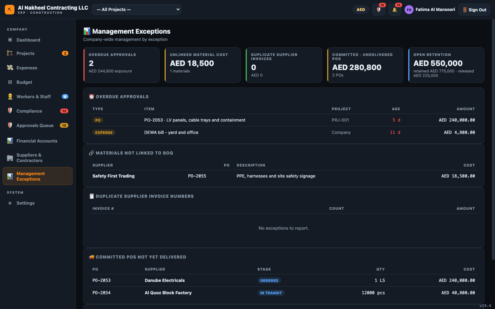

# المراقب المالي — دليل يوم العمل

يملك المراقب المالي مسؤولية **المال**: الاعتمادات (ضمن حدك)، الذمم المدينة/الدائنة، الرواتب،
المستحقات المحتجزة وطلبات الدفع. يمكنك الاعتماد والرفض، لكن حد صلاحيتك **محدد لكل جدول
(افتراضيًا 100,000 درهم)** — أي عنصر أكبر يُرفض ما لم يعتمده مدير. لا يمكنك إدارة المستخدمين
أو الاطلاع على السجل الكامل.

**يمكنه فتح:** لوحة التحكم، المشاريع، المصروفات، الميزانية، العمال، الامتثال، الإعدادات، الاعتمادات،
الحسابات المالية، الموردون والمقاولون، استثناءات الإدارة، وداخل المشروع — نظرة عامة، الكميات،
المخططات، الجدول، المواد، الدفعات، الأطراف، أوامر التغيير، الحضور، الرواتب، التدقيق، التقارير،
الفواتير المرحلية، تقارير الموقع، طلبات الدفع، قسائم الرواتب، الاستلام، المستحقات المحتجزة، وقياسات
وشهادات المقاولين. *(بدون المستخدمين والسجل.)*

---

## 1. بداية اليوم

1. سجّل الدخول → **لوحة تحكم الشركة**.
   
2. امسح إشعارات 🔔 (أغلق تنبيهات الامتثال/الميزانية أو علّم الكل كمقروء).

## 2. الاعتمادات (ضمن حدك)

1. افتح **🛡️ قائمة الاعتمادات** → تبويب **لي / المتأخر**.
   
2. راجع كل عنصر (🕓 السجل، 📎 المستندات). أرفق المستند عند اشتراط المبلغ.
3. **✓ اعتماد** أو **✕ رفض** (مع سبب). أي عنصر **فوق حدك يُرفض** — يجب أن يعتمده مدير. كما لا يمكنك
   اعتماد ما قدمته بنفسك.

## 3. الحسابات المالية (شاشتك الأساسية)

1. افتح **الحسابات المالية**: الذمم المدينة، الذمم الدائنة، الميزانية العمومية، الأرباح والخسائر.
   
2. أدخل/تحقق من **الأرصدة الافتتاحية** (الميزانية العمومية → الأرصدة الافتتاحية).
3. تأكد أن الميزانية تظهر شارة **متوازن** الخضراء.

## 4. الذمم الدائنة والنقد

1. **طلبات الدفع** — اعتمد مطالبات المقاولين/الموردين ضمن حدك، ثم حددها كمدفوعة.
   
2. **الدفعات** — سجّل المقبوضات/المدفوعات؛ تحديد فاتورة مورد **كمدفوعة** محظور حتى يكون لأمر
   الشراء الخاص بها سند استلام مطابق.
3. **الموردون والمقاولون** — حافظ على سجل الموردين (البنك/الرقم الضريبي/الشروط).
   

## 5. الرواتب والكوادر

1. **الرواتب** — شغّل الراتب الشهري الموحد (الأساسي + 1.5× ساعات إضافية معتمدة − القرض) الذي يحدّث
   أرصدة قروض العمال ويسجل مصروف الرواتب.
   
2. **قسائم الرواتب** — أنشئ واطبع قسيمة لكل عامل.
3. **العمال والكوادر** — راجع السجل (الرواتب، القروض).
4. **المصروفات** و**ميزانية الشركة** — اعتمد وراجع الإنفاق مقابل الميزانية.

## 6. إغلاق المشروع

1. **الفواتير المرحلية (IPC)** — اعتمد الفواتير المرحلية (يؤدي ذلك إلى مزامنة المستحق في الدفعات).
   
2. **المواد وأوامر الشراء** — اعتمد أوامر الشراء؛ وحوّل الأوامر المسلَّمة إلى فواتير موردين (🧾، تتطلب GRN).
   
3. **الاستلام (GRN)** — سجّل البضائع المستلمة (يفتح الفوترة/الدفع).
4. **المستحقات المحتجزة** — أفرج عن المستحقات لكل مشروع (≤ المفتوح، مع سبب).
   
5. **القياسات والشهادات** — اعتمد الكميات المقاسة وأنشئ طلبات دفع للمقاولين.

## 7. الرقابة

1. **استثناءات الإدارة** — راجع العلامات الحمراء (فواتير مكررة، تكاليف غير مرتبطة، اعتمادات متأخرة،
   أوامر ملتزم بها ولم تُسلَّم، مستحقات محتجزة مفتوحة).
   

## 8. نهاية اليوم

- تأكد من تصفير الاعتمادات (أو تصعيد العناصر فوق حدك إلى مدير).
- طابق الميزانية العمومية؛ ودوّن أي مستحقات محتجزة للإفراج.
- في نهاية الشهر أغلق الفترة من **🔒 الفترات ومدة الاعتماد** (إن مُنحت صلاحية مدير — وإلا اطلب من المدير).
