# مدير المشروع — دليل يوم العمل

يملك مدير المشروع **صلاحية كاملة**: يعتمد ويعتمد كل شيء، ويدير المستخدمين، ويراجع سجل التدقيق،
ويشغّل شاشات المال والإدارة. وهو الدور الوحيد الذي يمكنه الاعتماد دون سقف مالي، والوحيد الذي يمكنه
إدارة المستخدمين والاطلاع على السجل الكامل.

**يمكنه فتح:** لوحة التحكم، المشاريع، المصروفات، الميزانية، العمال، الامتثال، الإعدادات، **المستخدمون**،
**السجل**، الاعتمادات، الحسابات المالية، الموردون والمقاولون، استثناءات الإدارة، وداخل المشروع —
نظرة عامة، الكميات (BOQ)، المخططات، الجدول الزمني، المواد/أوامر الشراء، الدفعات، الأطراف، أوامر
التغيير، الحضور، الرواتب، التدقيق، التقارير، الفواتير المرحلية (IPC)، تقارير الموقع، طلبات الدفع،
قسائم الرواتب، الاستلام (GRN)، المستحقات المحتجزة، وقياسات وشهادات المقاولين.

---

## 1. بداية اليوم — نظرة على الشركة

1. سجّل الدخول. تصل إلى **لوحة تحكم الشركة** (مؤشرات: النقد، الاعتمادات المعلقة، التجاوزات، التنبيهات).
   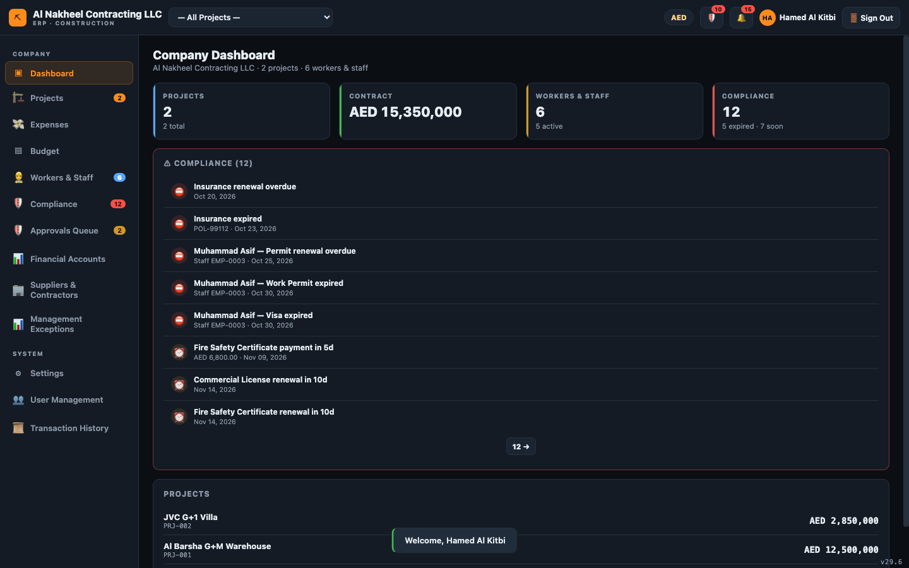
2. افتح **🔔 الإشعارات** وامسح أو تعامل مع تنبيهات الامتثال/الميزانية (أغلق بـ ✕ أو **تعليم الكل كمقروء**).
3. افتح **🛡️ قائمة الاعتمادات** — هذه مهمتك الصباحية الأساسية (الخطوة 2 أدناه).

## 2. تصفير قائمة الاعتمادات

1. افتح **قائمة الاعتمادات**. استخدم التبويبات للفرز: **الكل / لي / بواسطتي / المتأخر**.
   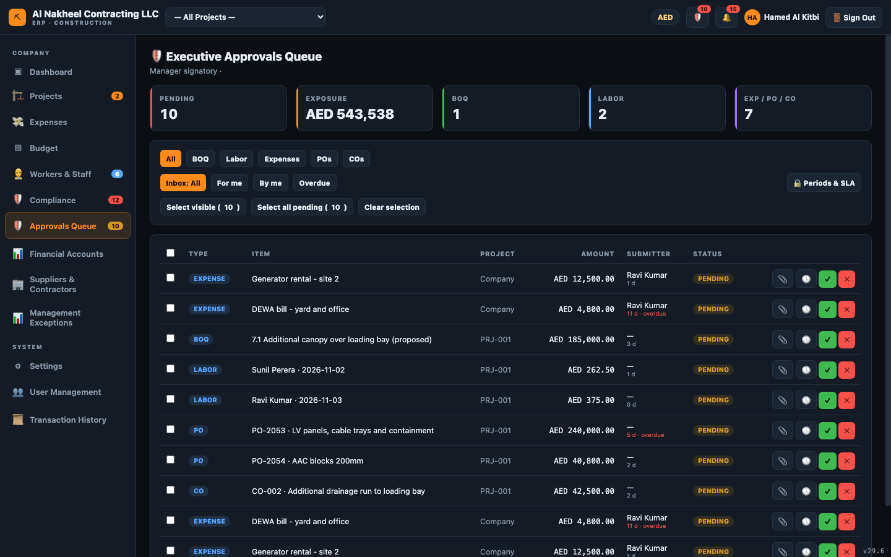
2. لكل عنصر معلق:
   - **🕓** يفتح سجل القرار؛ **📎** يفتح المستندات المرفقة.
   - إذا كان المبلغ يتطلب مستندًا ولم يُرفق، يرفض النظام — أرفق المستند أولًا (📎 → إضافة مستند).
   - **✓ اعتماد** أو **✕ رفض** (الرفض يتطلب سببًا).
   - لا يمكنك اعتماد ما قدمته بنفسك (فصل المهام).
3. كرر حتى تصبح القائمة فارغة.

## 3. الوضع المالي

1. افتح **الحسابات المالية** → الذمم المدينة، الذمم الدائنة، الميزانية العمومية، الأرباح والخسائر.
   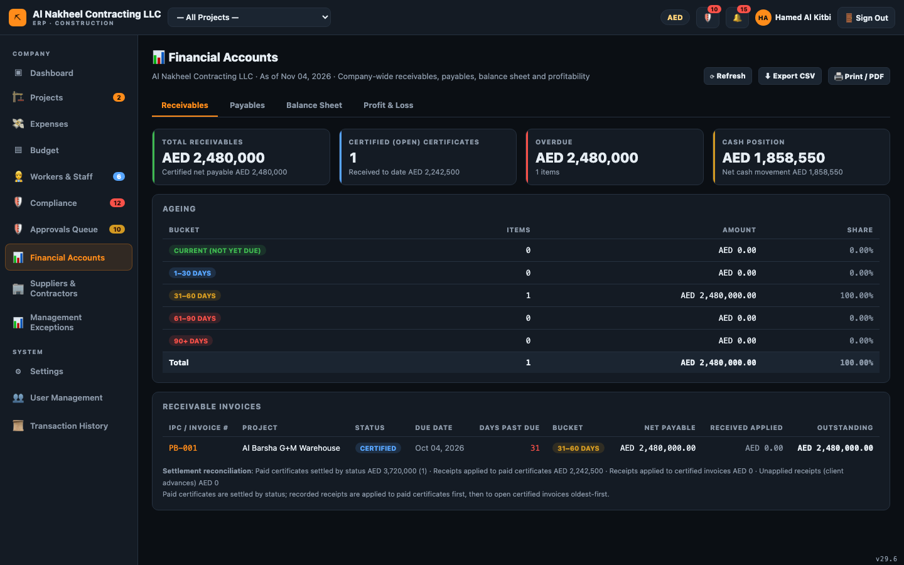
2. راجع **الميزانية العمومية** — تعرض صافي المستحقات المحتجزة بعد الإفراج، ويجب أن تظهر شارة
   «متوازن» الخضراء (الأصول = الخصوم + حقوق الملكية).
3. افتح **استثناءات الإدارة** لمراجعة العلامات الحمراء: الاعتمادات المتأخرة، التكاليف غير المرتبطة،
   فواتير الموردين المكررة، أوامر شراء ملتزم بها ولم تُسلَّم، المستحقات المحتجزة المفتوحة.
   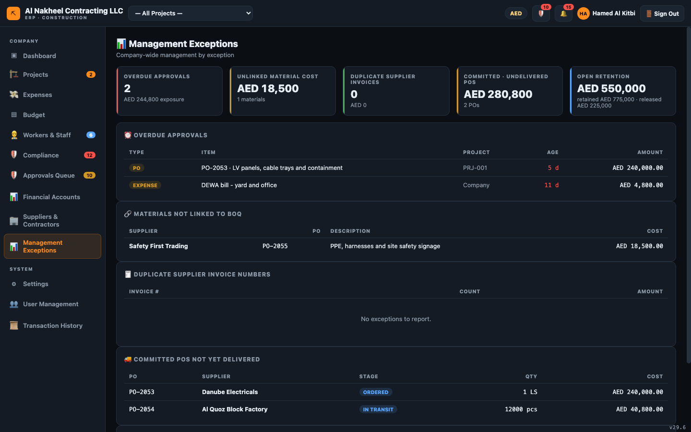

## 4. الموردون والميزانية والكوادر

1. **الموردون والمقاولون** — حافظ على سجل الموردين على مستوى الشركة واربطهم بالمشاريع
   (البنك/الرقم الضريبي/شروط الدفع هنا).
   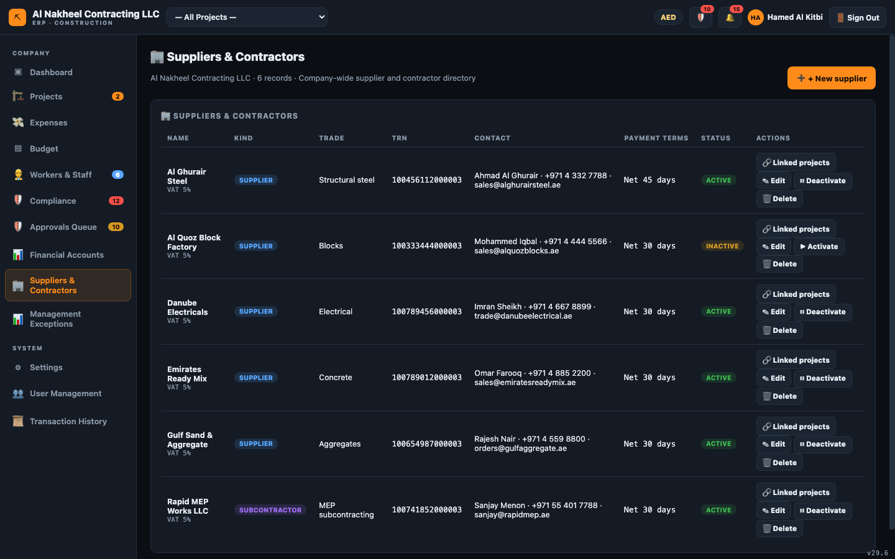
2. **ميزانية الشركة** و**المصروفات** — راجع الإنفاق مقابل الميزانية واعتمد المصروفات.
3. **العمال والكوادر** — حافظ على السجل (الراتب، رصيد القروض، التصاريح).
4. **الامتثال** — تحقق من انتهاء التصاريح/التأشيرات وتعامل مع المتجاوز.

## 5. العمل على مشروع (اختر واحدًا من الشريط العلوي)

1. افتح مشروعًا → **نظرة عامة** لمؤشرات المشروع.
   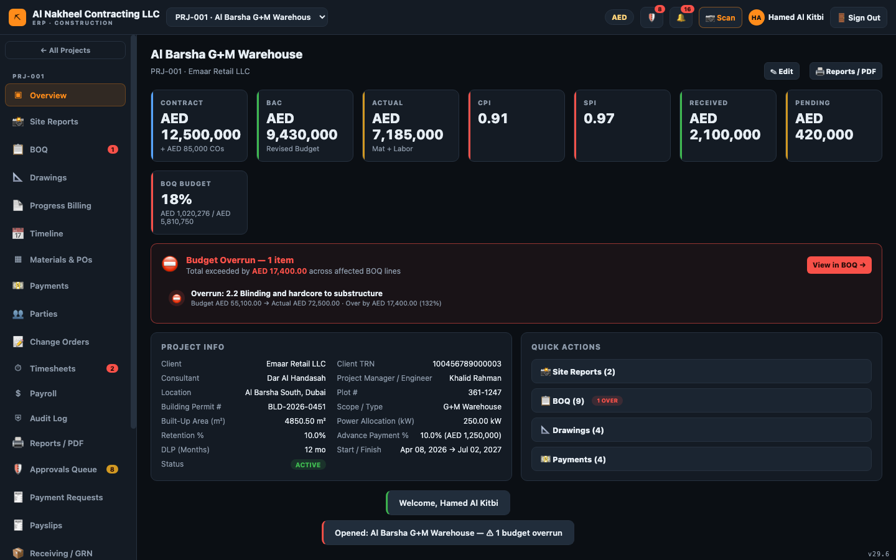
2. **الكميات (BOQ)** — راجع الميزانية مقابل **الفعلي** مقابل **الملتزم** (أوامر الشراء قيد الطلب/الترانزيت
   تظهر ملتزمًا بها وليست فعليًا).
   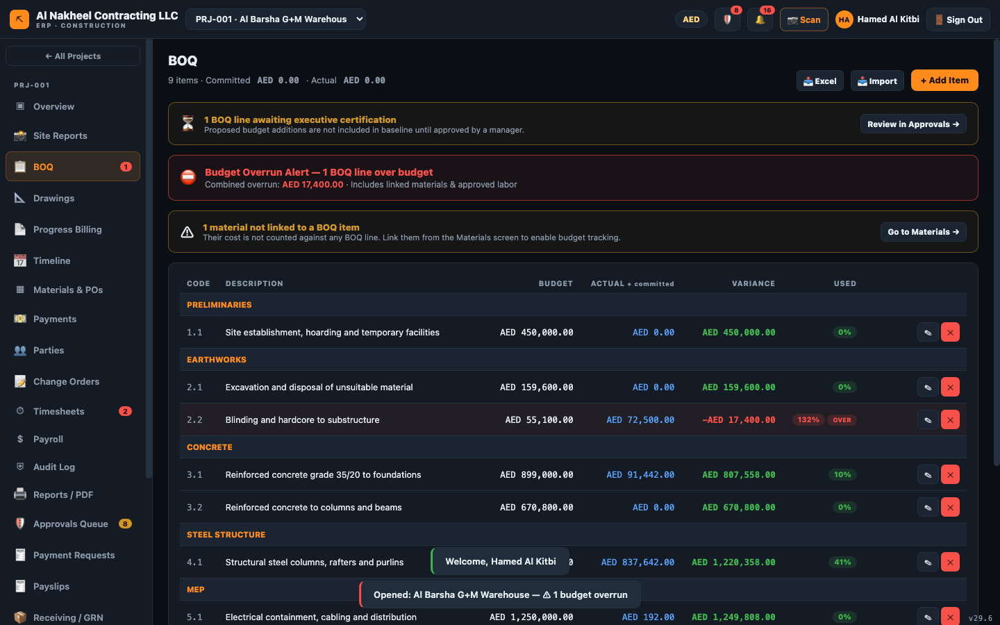
3. **الفواتير المرحلية (IPC)** — أنشئ/اعتمد الفواتير المرحلية. الاعتماد يزامن المستحق في الدفعات.
   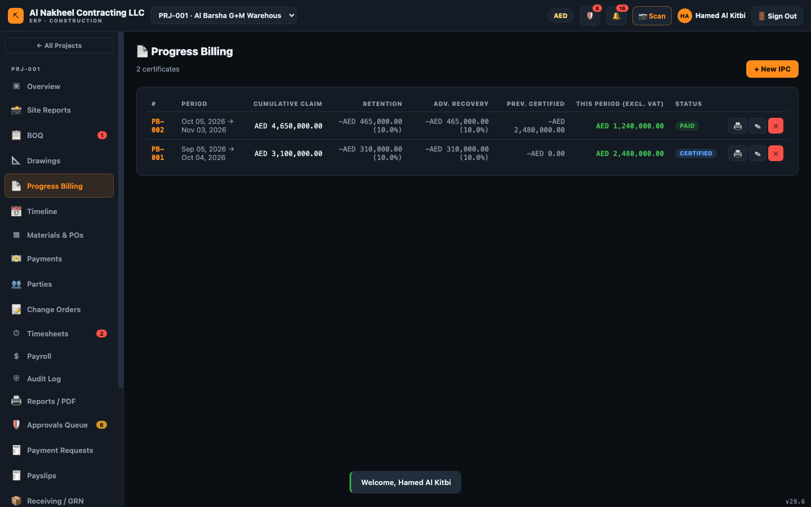
4. **المواد وأوامر الشراء** — اعتمد أوامر الشراء؛ وعند أمر شراء مسلَّم ومعتمد اضغط **🧾** لتحويله إلى
   فاتورة مورد دائنة (5% ضريبة، شروط 30 يومًا). يلزم سند استلام أولًا (المطابقة الثلاثية).
   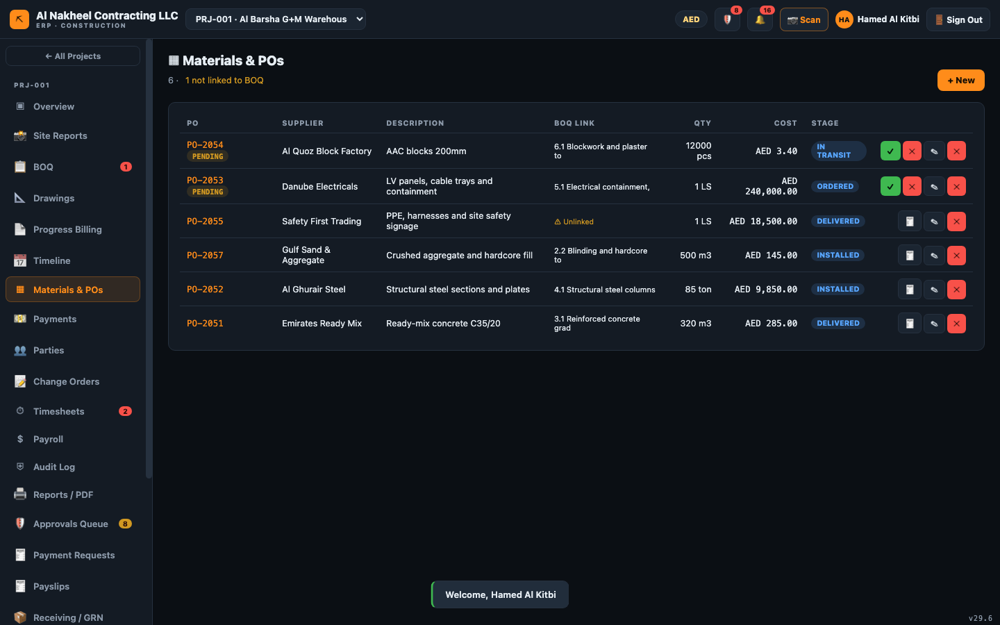
5. **أوامر التغيير** — اعتمدها؛ وأمر التغيير المعتمد ينشئ تلقائيًا سطر **تغييرات** في الكميات.
   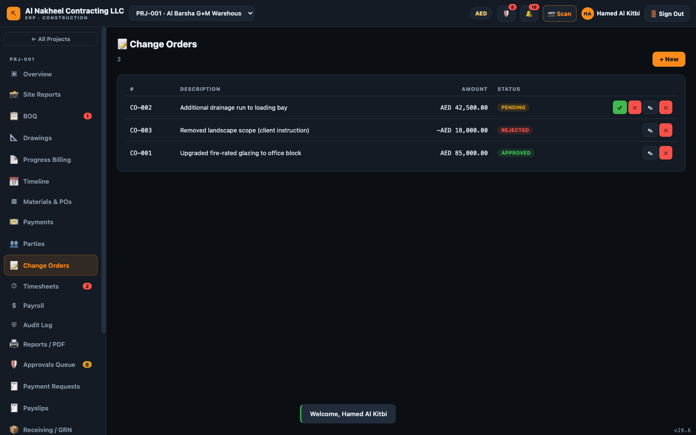
6. **طلبات الدفع** — اعتمد مطالبات المقاولين/الموردين (تقديم → اعتماد → تحديد كمدفوع).
   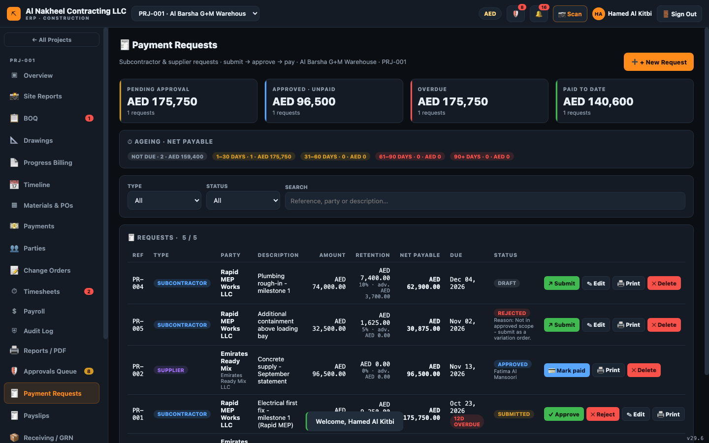

## 6. الموقع والعمالة

1. **الحضور** — راجع الحضور المقدم؛ واعتمده.
2. **الرواتب** — شغّل **الراتب الشهري الموحد** (الأساسي + 1.5× ساعات إضافية معتمدة − القرض) الذي يحدّث
   رصيد قرض كل عامل ويسجل مصروف الرواتب.
   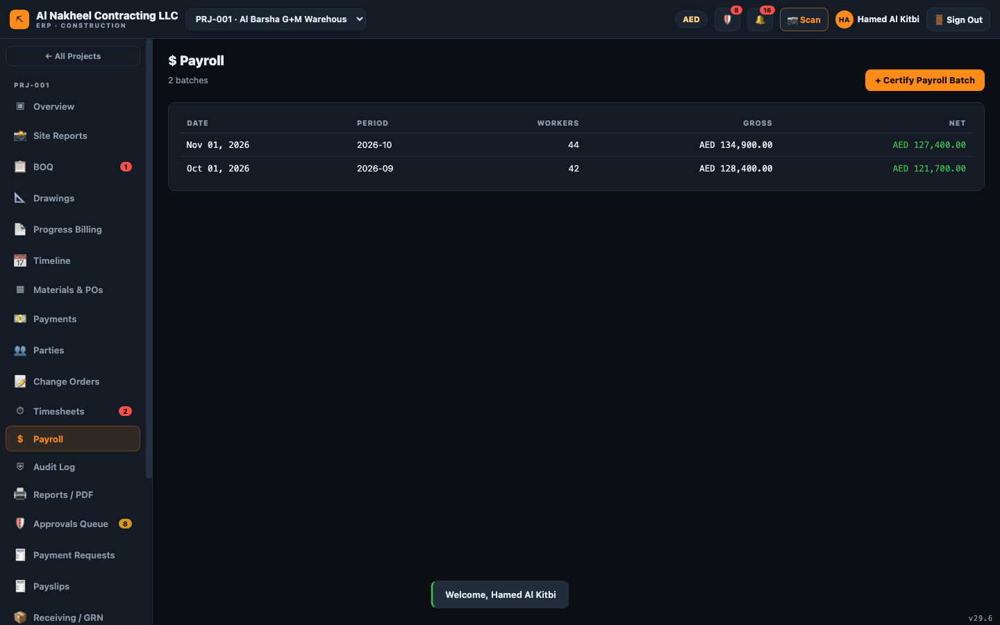
3. **قسائم الرواتب** — أنشئ قسيمة لكل عامل واطبعها/صدّرها PDF.
4. **تقارير الموقع** — راجع التقارير اليومية مع الصور.
   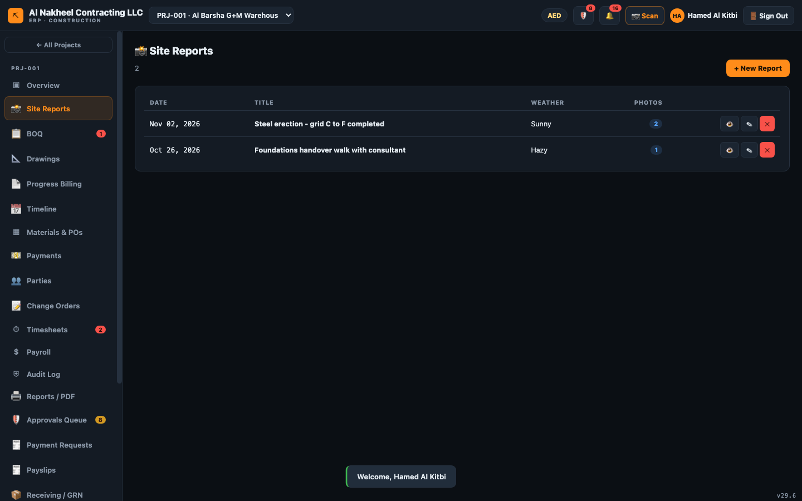

## 7. الاستلام والمستحقات والشهادات

1. **الاستلام (GRN)** — سجّل البضائع المستلمة مقابل أوامر الشراء (يفتح تحويل الفاتورة والدفع).
   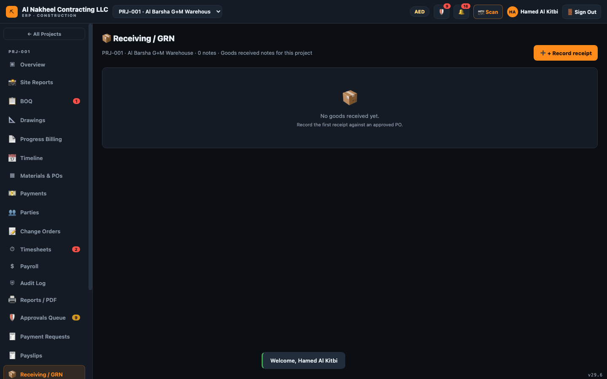
2. **المستحقات المحتجزة** — أفرج عن المستحقات لكل مشروع (المبلغ ≤ المفتوح، مع سبب).
   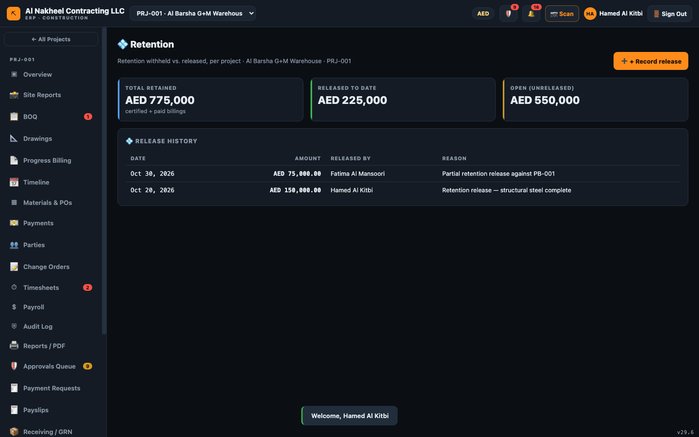
3. **القياسات والشهادات** — قِس كميات الكميات، اعتمد، وأنشئ طلب دفع للمقاول.
   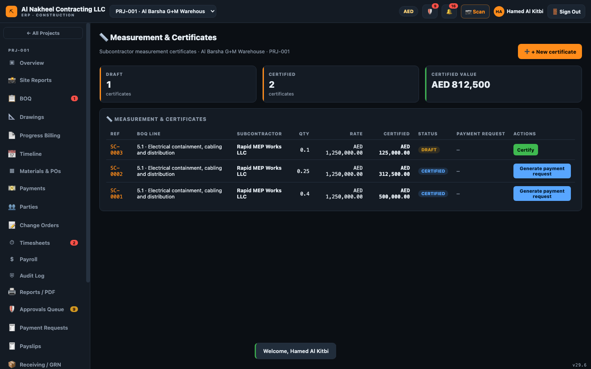

## 8. نهاية الشهر والحوكمة

1. افتح **🔒 الفترات ومدة الاعتماد** (في رأس الاعتمادات) → أغلق الشهر لقفل الكتابة، وحدد مدة الاعتماد بالأيام.
2. **المستخدمون** — أضف/عطّل المستخدمين، حدد الأدوار، أعد تعيين كلمات المرور.
   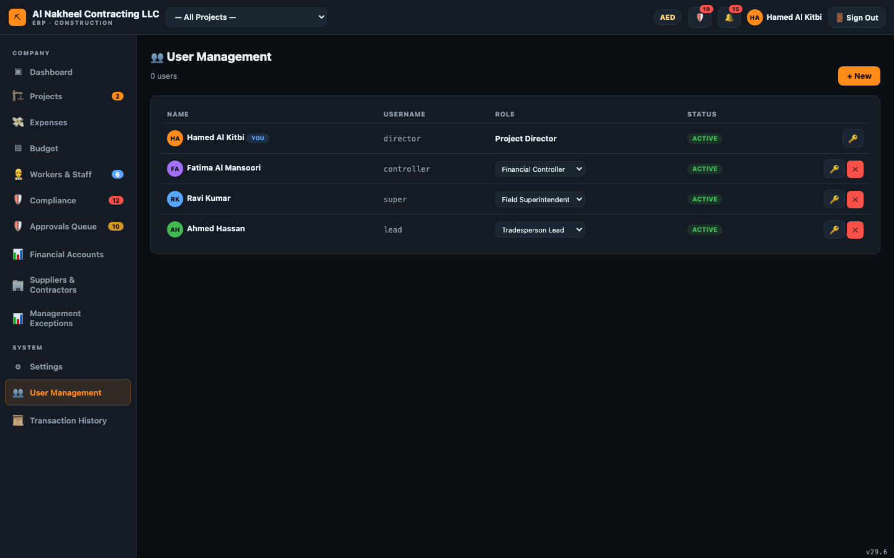
3. **السجل** — راجع سجل التدقيق الكامل (من فعل ماذا ومتى).
   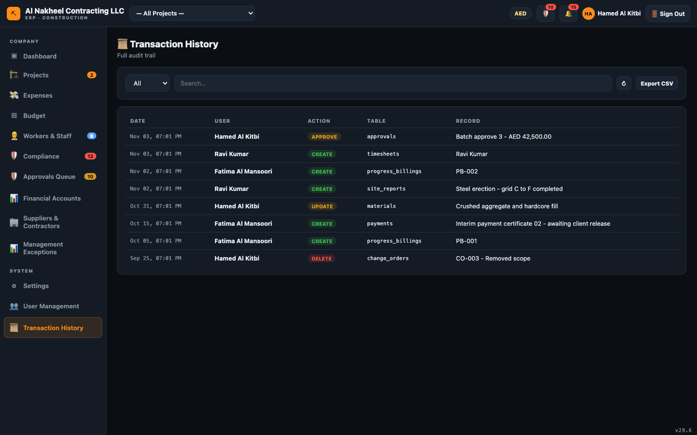
4. **الإعدادات** — الشعار واللغة والمظهر.

## 9. نهاية اليوم

- تأكد أن قائمة الاعتمادات فارغة (أو مفوَّضة/مؤشرة).
- تحقق من شارة «متوازن» في الميزانية وشاشة استثناءات الإدارة لأي عنصر أحمر.
- إذا كانت نهاية الشهر أغلق الفترة؛ وإذا كان يوم الرواتب فاعتمد تشغيل الرواتب.
