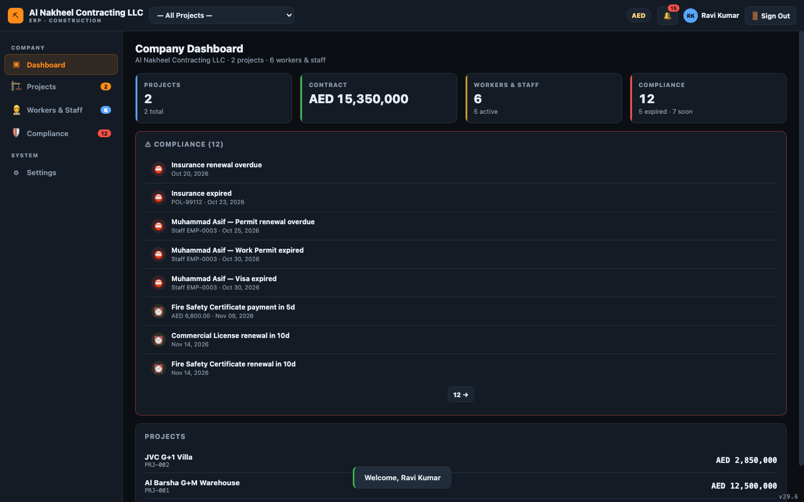
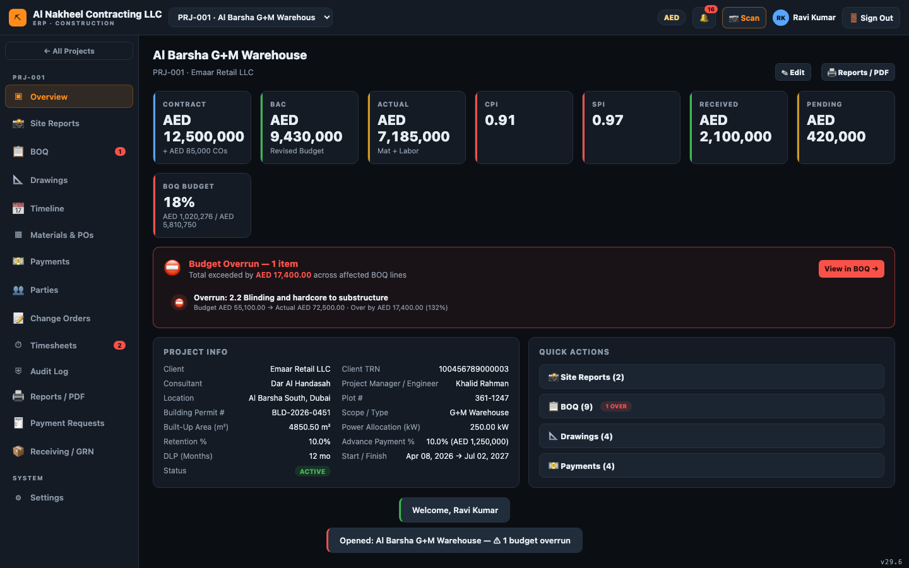
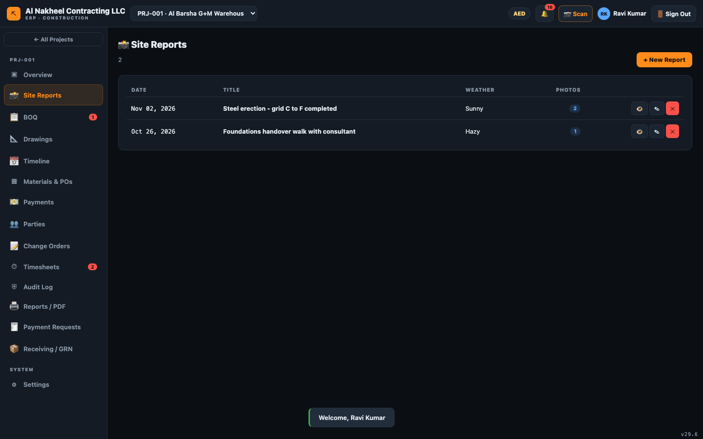
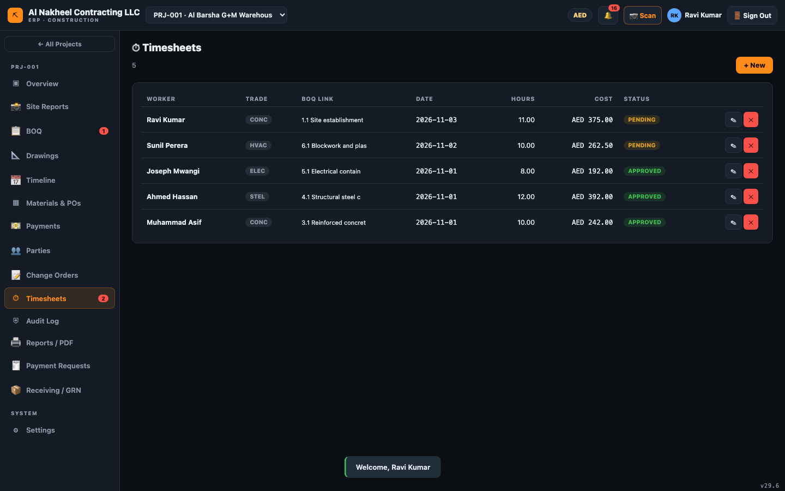
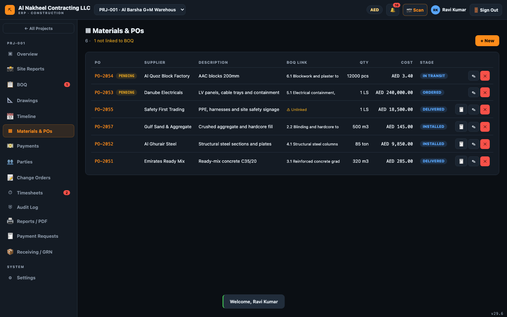
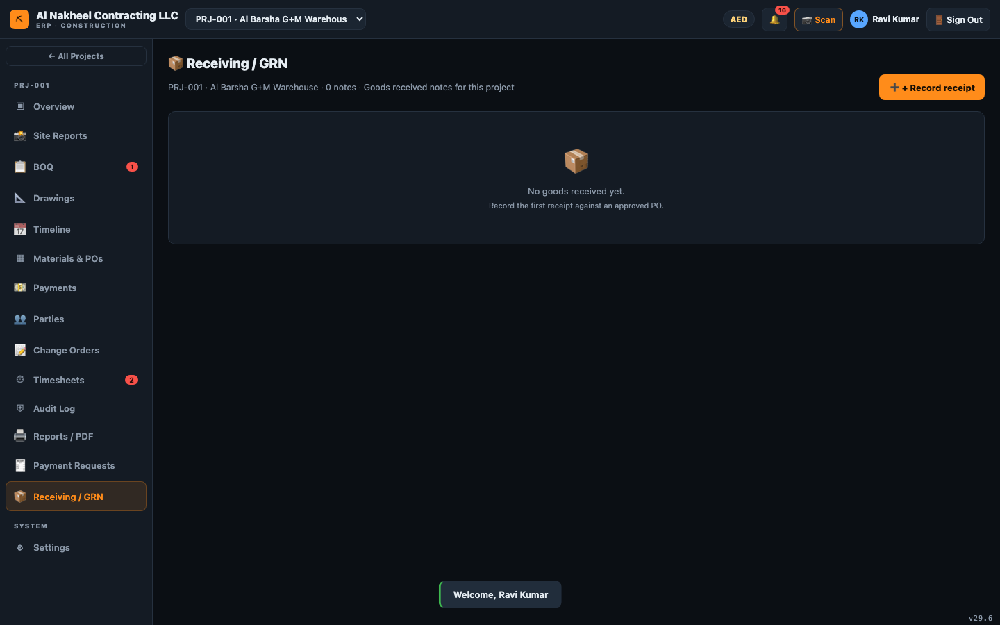
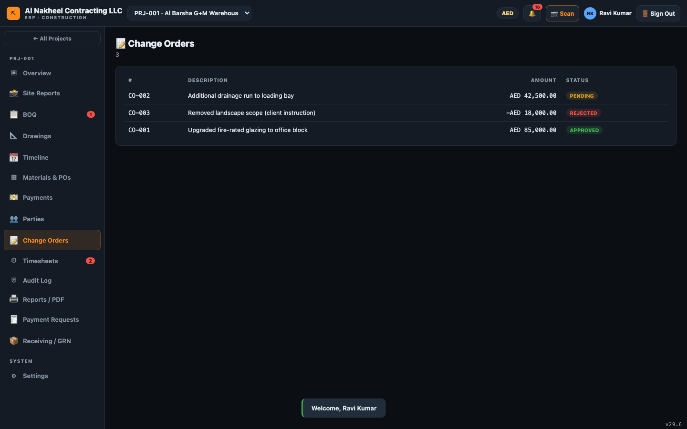
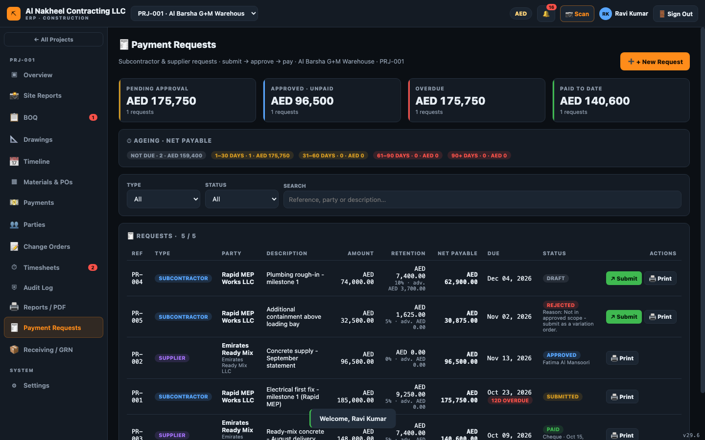

# مهندس الموقع — دليل يوم العمل

يسجّل مهندس الموقع ما يحدث في الموقع و**يقدّمه** للاعتماد. أنت تقوم بإدخال بيانات الميدان —
التقارير اليومية، الحضور، أوامر الشراء، أوامر التغيير، طلبات الدفع وسندات الاستلام — لكنك **لا**
تعتمد/تقر (المديرون يفعلون ذلك). ليس لديك وصول إلى الحسابات المالية أو الرواتب أو المستحقات
المحتجزة أو قسائم الرواتب أو قائمة الاعتمادات.

**يمكنه فتح:** لوحة التحكم، المشاريع، العمال، الامتثال، الإعدادات، وداخل المشروع — نظرة عامة،
الكميات، المخططات، الجدول الزمني، المواد/أوامر الشراء، الدفعات، الأطراف، أوامر التغيير، الحضور،
التدقيق، التقارير، تقارير الموقع، طلبات الدفع، والاستلام (GRN).

---

## 1. بداية اليوم

1. سجّل الدخول → **لوحة تحكم الشركة** (تنبيهات التصاريح/التأشيرات/الامتثال التي تحتاج انتباهك).
   
2. امسح إشعارات 🔔؛ وتعامل مع تنبيهات الامتثال (تصاريح منتهية، مستندات).

## 2. اختر مشروعك

1. اختر المشروع من الشريط العلوي → **نظرة عامة**.
   

## 3. سجّل عمل اليوم

1. **تقارير الموقع** → **+ تقرير جديد** → التاريخ، الطقس، القوى العاملة، الأنشطة، المشكلات، السلامة،
   وأرفق الصور (تُرفع إلى التخزين السحابي).
   
2. **الحضور** → **+ جديد** → اختر العامل (مرتبط بسجل الكوادر)، سطر الكميات، التاريخ، الساعات النظامية
   والإضافية. التقديم يجعله **معلقًا** ليعتمده مدير.
   

## 4. المشتريات والاستلام

1. **المواد وأوامر الشراء** → **+ جديد** لرفع أمر شراء. يُحفظ **معلقًا** حتى يعتمده مدير.
   
2. **الاستلام (GRN)** → **+ سجل استلام** عند وصول البضاعة (يربط أمر الشراء ويسجل الكمية المستلمة — وهذا
   ما يفتح الفوترة لاحقًا).
   

## 5. التغييرات وطلبات الدفع

1. **أوامر التغيير** → **+ جديد** لرفع تغيير (معلق حتى الاعتماد؛ والاعتماد يضيف تلقائيًا سطر تغييرات في الكميات).
   
2. **طلبات الدفع** → **+ جديد** لرفع مطالبة مقاول/مورد ليعتمدها مدير.
   

## 6. تتبع التقدم

1. **الكميات (BOQ)** — راجع الميزانية/الفعلي/الملتزم لكل سطر.
2. **المخططات** و**الجدول الزمني** — اطلع على المخططات/المراجعات والجدول.
3. **التقارير** — اطبع تقارير المشروع/PDF.

## 7. نهاية اليوم

- قدّم التقرير اليومي (مع الصور) قبل المغادرة.
- تأكد من تقديم الحضور وأي أوامر شراء/تغيير (لا تتركها مسودات).
- تحقق من لوحة 🔔 لأي عنصر أغلقته ويتطلب فعلاً إجراء من مدير.
