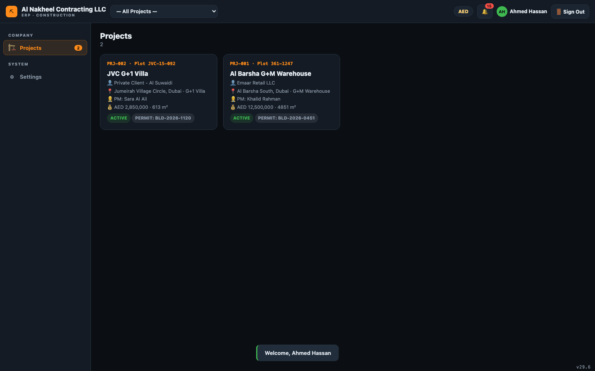
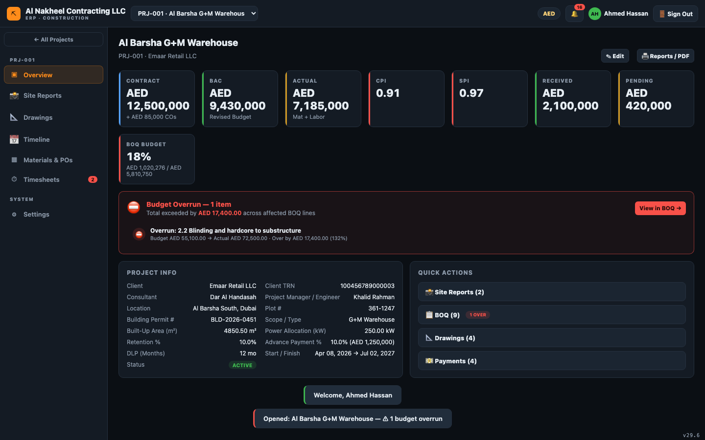
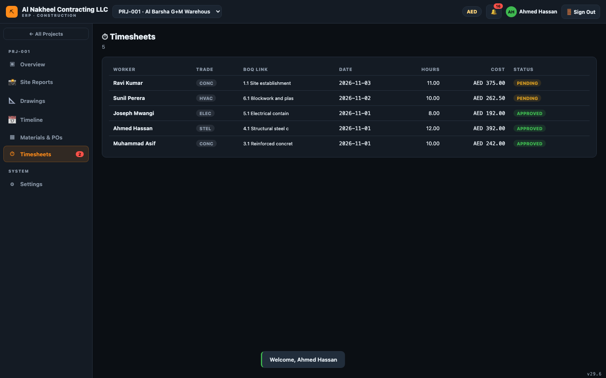
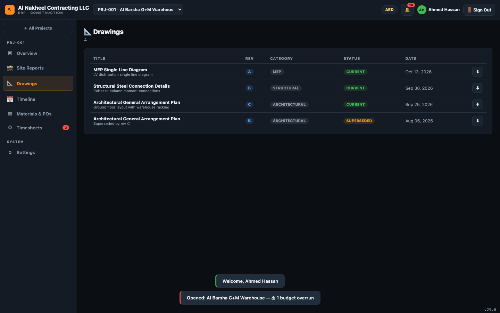
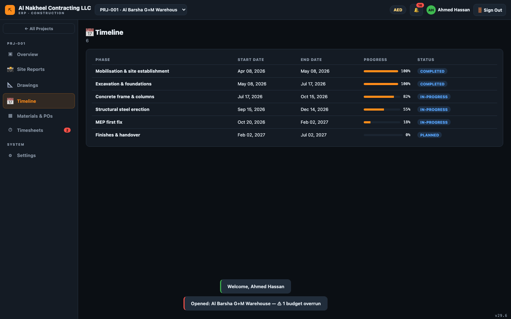
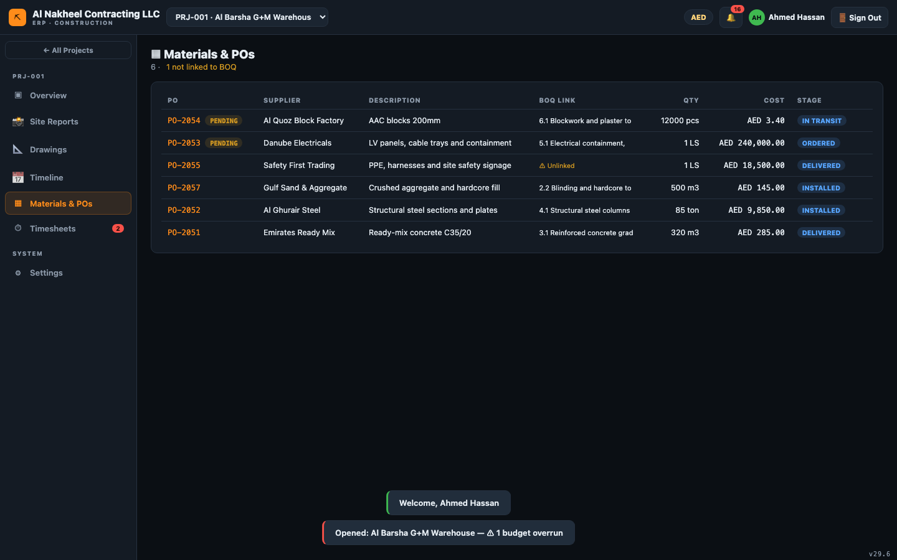
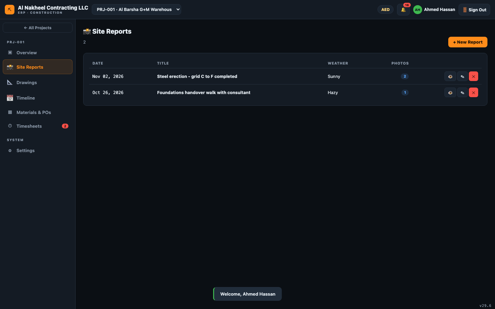

# رئيس العمال (فورمان) — دليل يوم العمل

يملك رئيس العمال أضيق صلاحية: تسجيل عمله والاطلاع على ما يحتاجه في الموقع. لا يمكنه رؤية الكميات
أو الاعتمادات أو المالية أو الرواتب أو بيانات الدفع.

**يمكنه فتح:** المشاريع، وداخل المشروع — نظرة عامة، المخططات، الجدول الزمني، المواد/أوامر الشراء،
الحضور، الإعدادات، وتقارير الموقع.

---

## 1. بداية اليوم

1. سجّل الدخول → قائمة **المشاريع**؛ اختر مشروعك من الشريط العلوي.
   
2. افتح **نظرة عامة** لرؤية ملخص المشروع.
   

## 2. سجّل ساعات عملك

1. **الحضور** → **+ جديد** → اختر اسمك (قائمة العمال)، النشاط/الكمية، التاريخ، الساعات النظامية
   والإضافية. التقديم يجعله **معلقًا** ليعتمده مدير.
   

## 3. راجع المخططات والجدول

1. **المخططات** — اطلع على أحدث المخططات/المراجعات.
   
2. **الجدول الزمني** — تحقق من مهام اليوم والقادمة.
   

## 4. المواد

1. **المواد** — اطلع على أوامر الشراء ومرحلتها (قيد الطلب / في الترانزيت / مسلَّم / مركّب) لتعرف
   المواد المتوقع وصولها للموقع.
   

## 5. تقرير الموقع

1. **تقارير الموقع** → **+ تقرير جديد** — سجّل أنشطة اليوم والمشكلات وملاحظات السلامة، وأرفق الصور.
   

## 6. نهاية اليوم

- تأكد من تقديم سجل حضورك لليوم.
- قدّم التقرير اليومي مع الصور.
- دوّن أي شيء للغد في خانة «المشكلات» بالتقرير حتى يراه المهندس.
