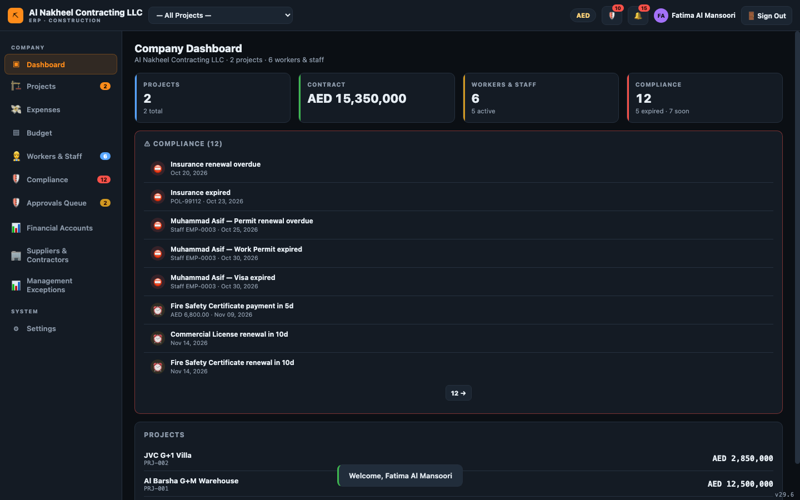
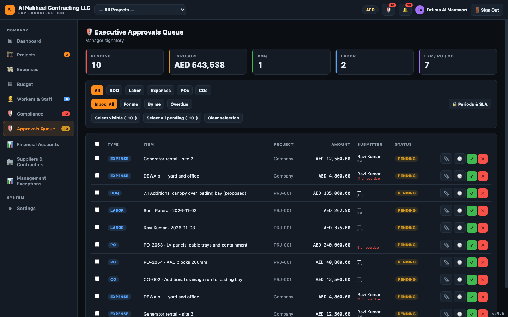
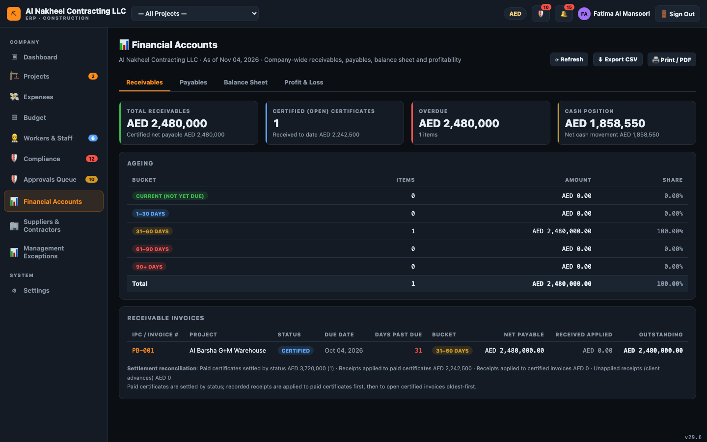
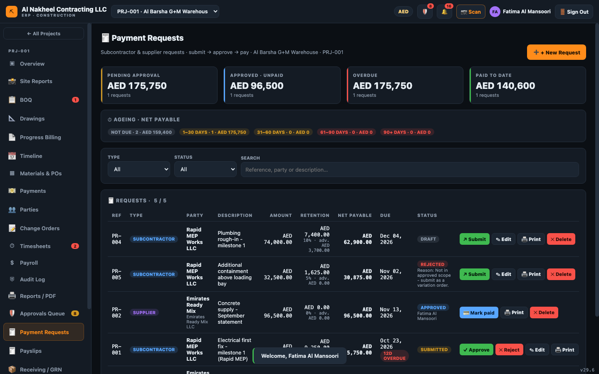
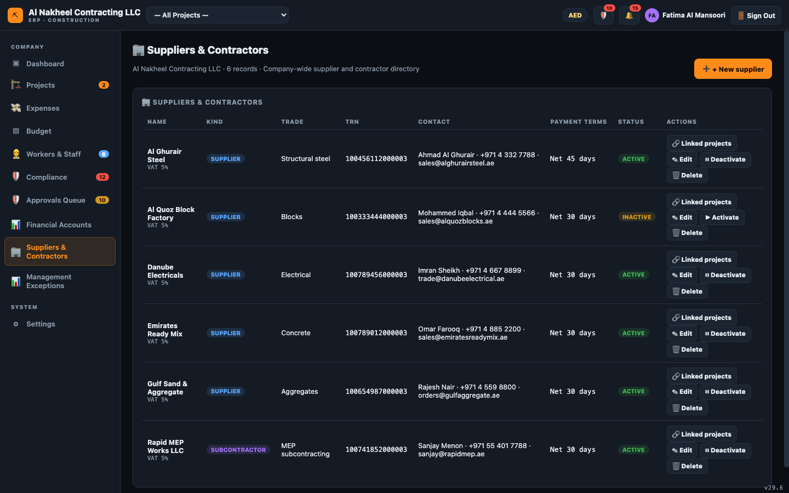
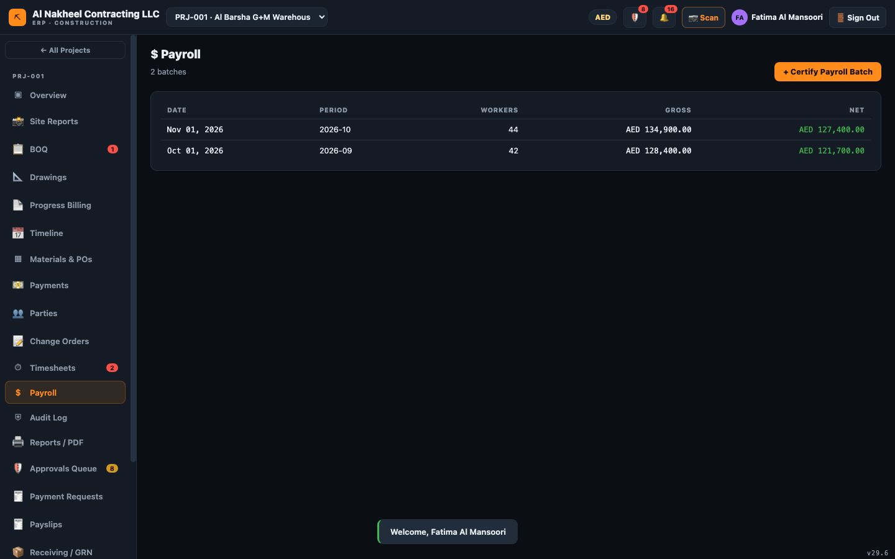
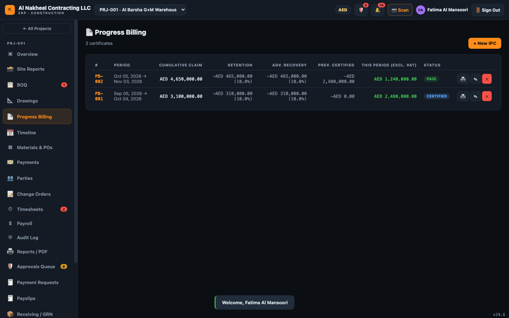
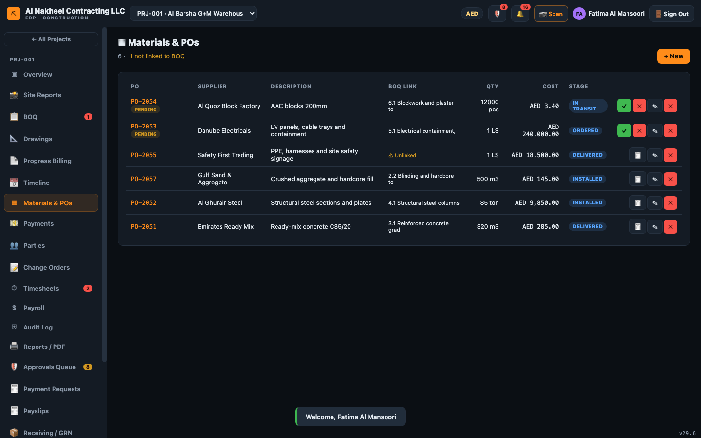
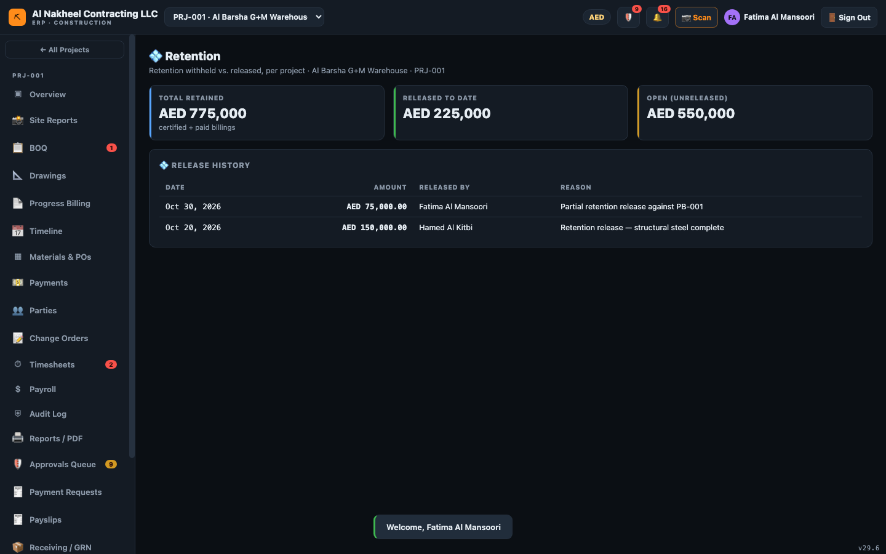
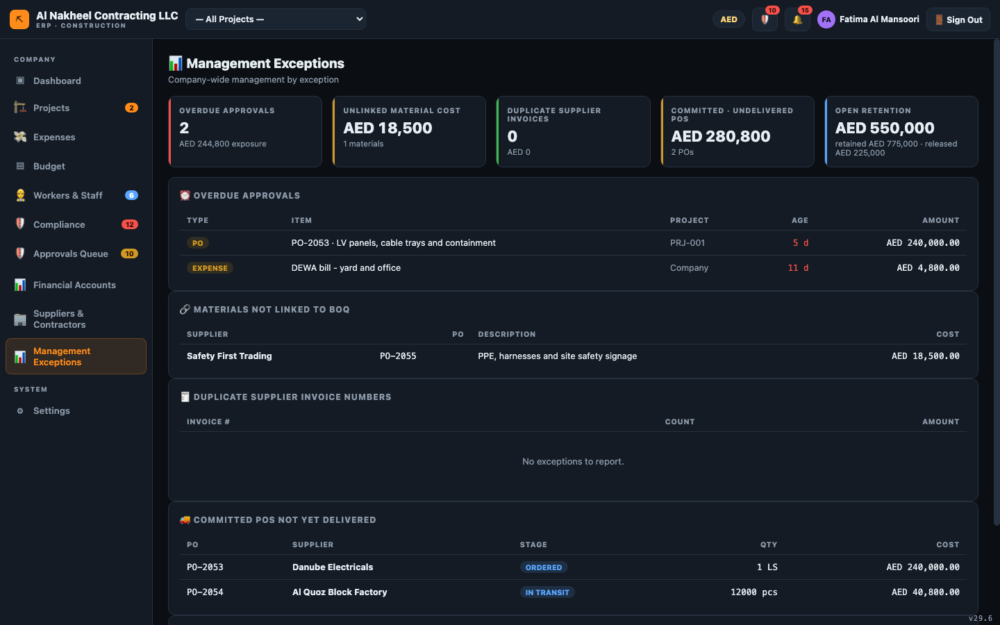

# Financial Controller — Day Guide

The Financial Controller owns the **money**: approvals (within your limit), receivables/payables,
payroll, retention and payment requests. You can approve and reject, but your limit of authority is
**capped per table (default AED 100,000)** — anything larger is refused unless a Director approves it.
You cannot manage users or view the full history.

**You can open:** Dashboard, Projects, Expenses, Budget, Workers, Compliance, Settings, Approvals,
Financial Accounts, Suppliers & Contractors, Management Exceptions, and — inside a project — Overview,
BOQ, Drawings, Timeline, Materials/POs, Payments, Parties, Change Orders, Timesheets, Payroll, Audit,
Reports, Progress Billing, Site Reports, Payment Requests, Payslips, Receiving/GRN, Retention, and
Measurement & Certificates. *(No Users, no History.)*

---

## 1. Start of day

1. Sign in → **Company Dashboard**.
   
2. Clear the 🔔 notifications (dismiss compliance/budget alerts or Mark all read).

## 2. Approvals (within your limit)

1. Open **🛡️ Approvals Queue** → **For me / Overdue** tabs.
   
2. Review each item (🕓 history, 📎 evidence). Attach evidence when the amount requires it.
3. **✓ Approve** or **✕ Reject** (with reason). An item **above your limit is refused** — a Director
   must sign it. You also cannot approve your own submission.

## 3. Financial accounts (your core screen)

1. Open **Financial Accounts**: Receivables, Payables, Balance Sheet, Profit & Loss.
   
2. Enter/verify **opening balances** (Balance Sheet → Opening balances).
3. Confirm the balance sheet shows the green **Balanced** badge.

## 4. Payables & cash

1. **Payment Requests** — approve subcontractor/supplier claims within your limit, then mark them paid.
   
2. **Payments** — record receipts/payments; marking a supplier invoice **paid** is blocked until its
   PO has a matching goods receipt.
3. **Suppliers & Contractors** — maintain the vendor master (bank/TRN/terms).
   

## 5. Payroll & people

1. **Payroll** — run the unified monthly payroll (basic + 1.5× approved OT − loan), which updates
   worker loan balances and posts the salaries expense.
   
2. **Payslips** — generate and print per-worker slips.
3. **Workers & Staff** — review the register (salary, loans).
4. **Expenses** and **Company Budget** — approve and review spend vs budget.

## 6. Project close-out

1. **Progress Billing (IPC)** — certify IPCs (this syncs the receivable into Payments).
   
2. **Materials & POs** — approve POs; convert delivered POs to supplier bills (🧾, requires GRN).
   
3. **Receiving / GRN** — record goods received (unblocks billing/payment).
4. **Retention** — release retention per project (≤ open, reason required).
   
5. **Measurement & Certificates** — certify measured quantities and generate subcontractor payment
   requests.

## 7. Oversight

1. **Management Exceptions** — review red flags (duplicate invoices, unlinked costs, overdue approvals,
   committed-not-delivered POs, open retention).
   

## 8. End of day

- Confirm approvals cleared (or escalated to a Director for over-limit items).
- Reconcile the balance sheet; note any open retention to release.
- At month-end, close the period from **🔒 Periods & SLA** (if you have been granted director rights
  to do so — otherwise ask the Director).
