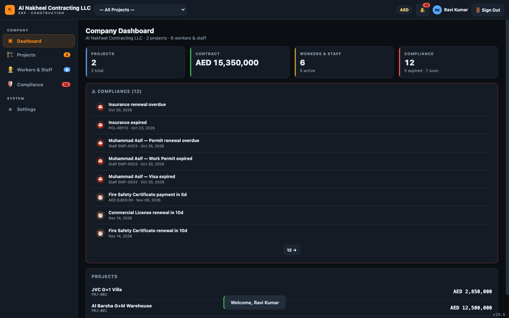
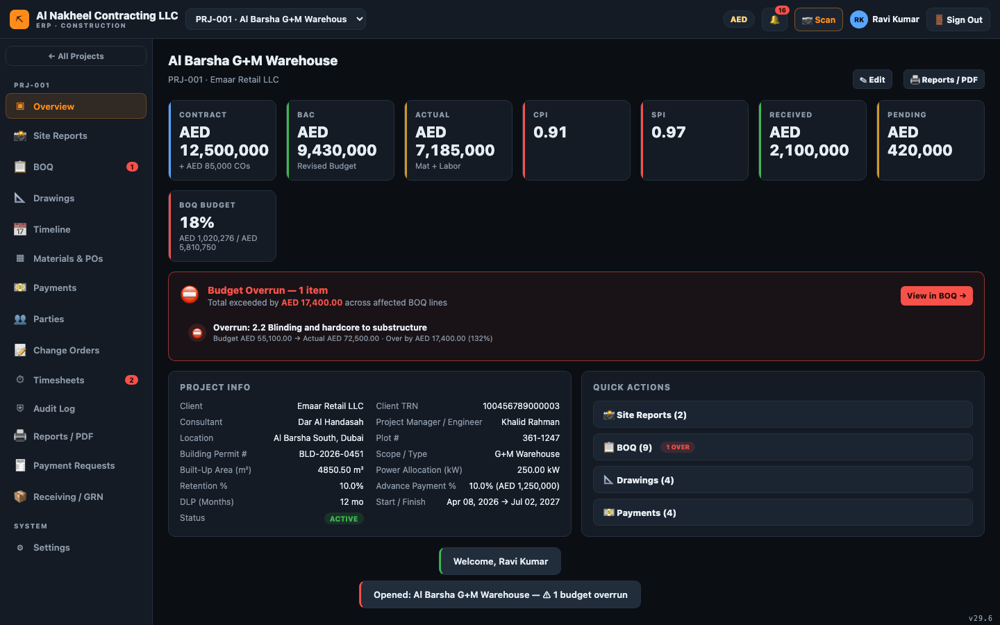
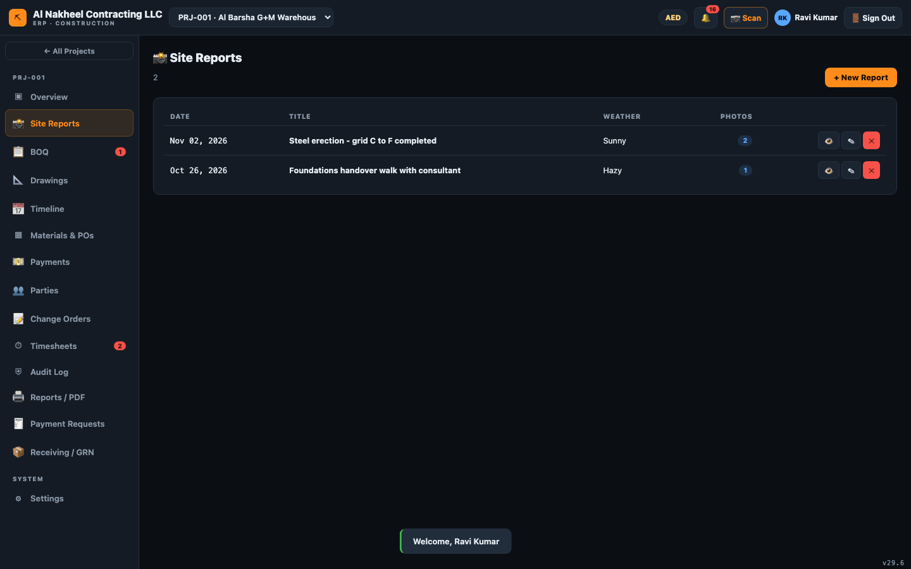
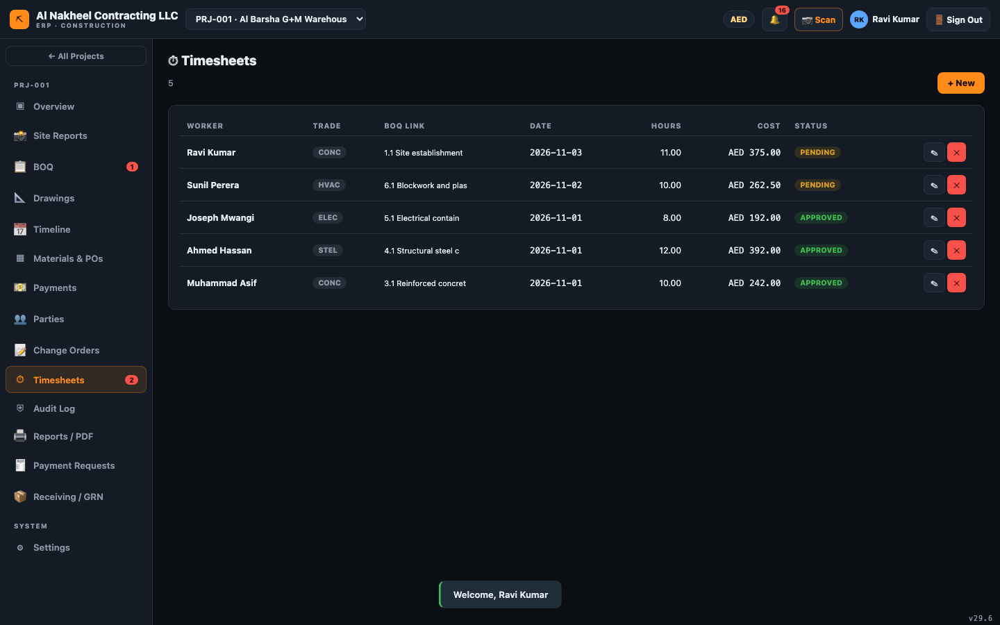
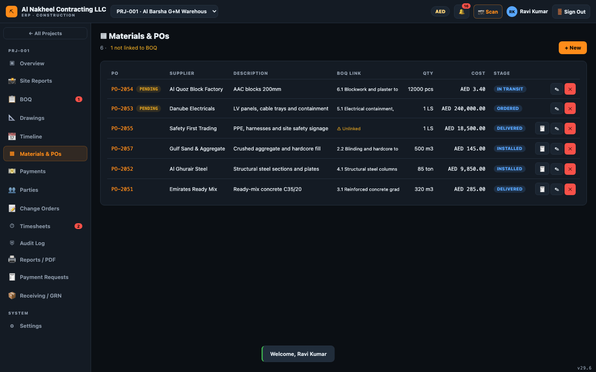
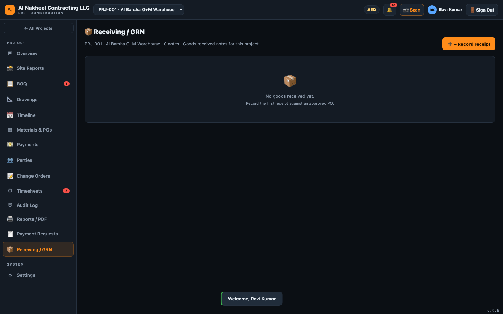
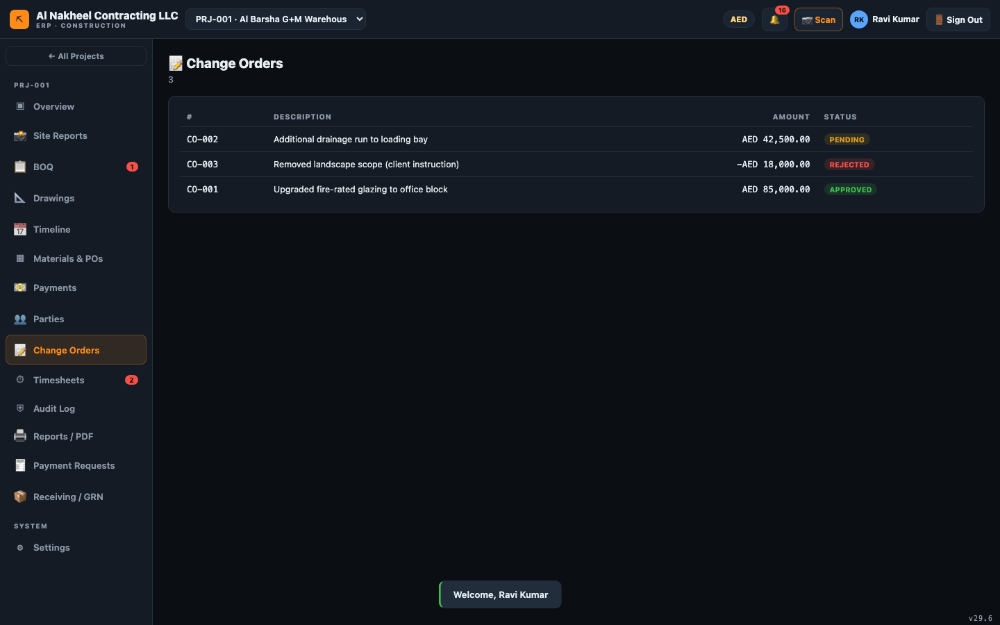
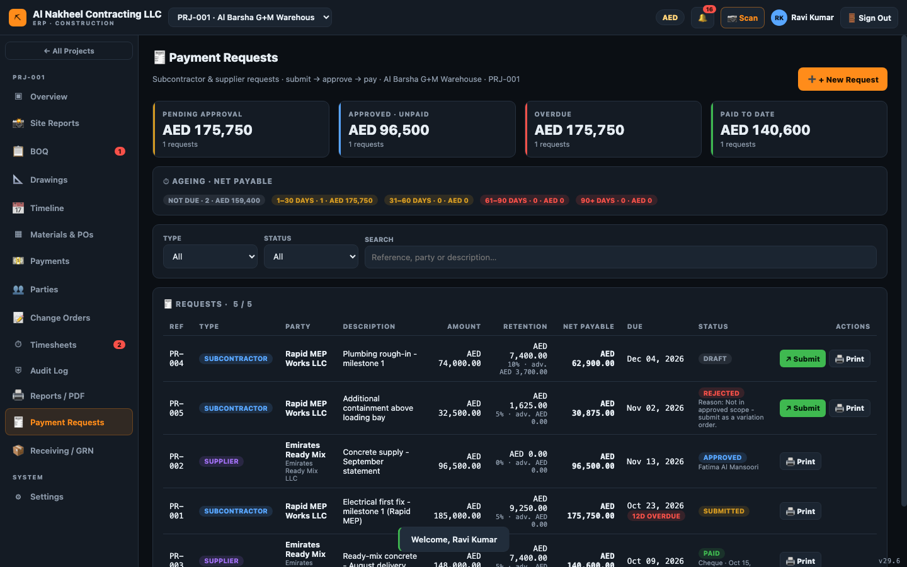

# Field Superintendent — Day Guide

The Field Superintendent records what happens on site and **submits** it for approval. You do the
field data entry — daily reports, timesheets, purchase orders, change orders, payment requests and
goods receipts — but you do **not** approve/certify (managers do). You have no access to the financial
accounts, payroll, retention, payslips or the approvals queue.

**You can open:** Dashboard, Projects, Workers, Compliance, Settings, and — inside a project — Overview,
BOQ, Drawings, Timeline, Materials/POs, Payments, Parties, Change Orders, Timesheets, Audit, Reports,
Site Reports, Payment Requests, and Receiving/GRN.

---

## 1. Start of day

1. Sign in → **Company Dashboard** (alerts for permits/visas/compliance that need your attention).
   
2. Clear the 🔔 notifications; act on compliance alerts (expiring permits, documents).

## 2. Pick your project

1. Choose the project from the top bar → **Overview**.
   

## 3. Log the day's work

1. **Site Reports** → **+ New Report** → date, weather, workforce, activities, issues, safety, and
   attach photos (they upload to cloud storage).
   
2. **Timesheets** → **+ New** → pick the worker (linked to the staff register), BOQ line, date,
   regular + OT hours. Submitting sets it to **pending** for a manager to approve.
   

## 4. Procurement & receiving

1. **Materials & POs** → **+ New** to raise a purchase order. It saves as **pending** until a manager
   approves it.
   
2. **Receiving / GRN** → **+ Record receipt** when goods arrive (links the PO and records the quantity
   received — this is what later unblocks billing).
   

## 5. Variations & payment requests

1. **Change Orders** → **+ New** to raise a variation (pending until approved; approval auto-adds a
   BOQ variation line).
   
2. **Payment Requests** → **+ New** to raise a subcontractor/supplier claim for a manager to approve.
   

## 6. Track progress

1. **BOQ** — view budget/actual/committed per line.
2. **Drawings** and **Timeline** — view drawings/revisions and the schedule.
3. **Reports** — print project reports/PDF.

## 7. End of day

- Submit the daily site report (with photos) before leaving.
- Confirm timesheets and any POs/COs are submitted (not left in draft).
- Check the 🔔 panel for anything you dismissed that actually needs a manager's action.
