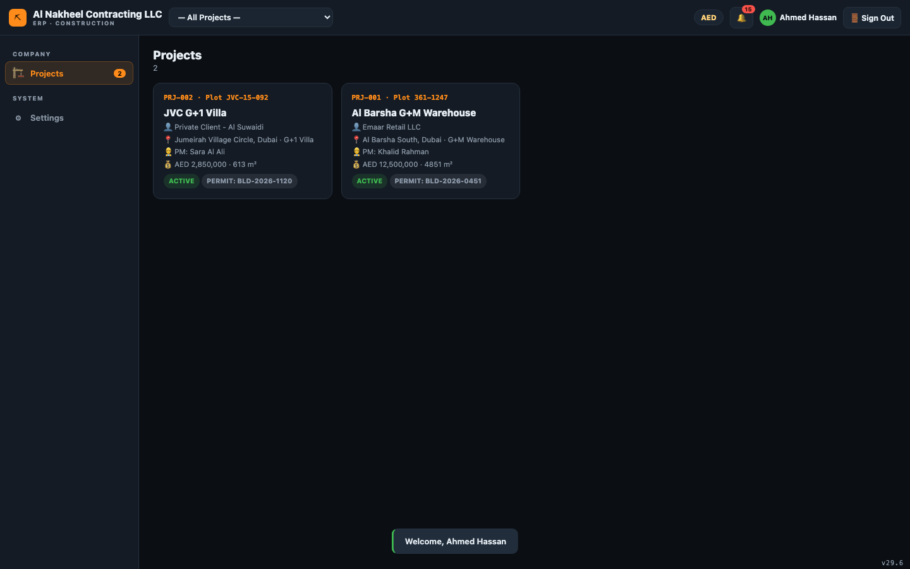
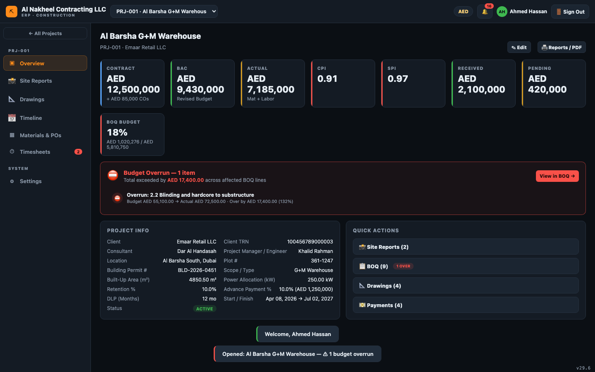
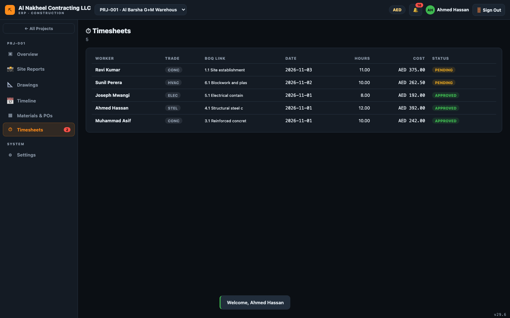
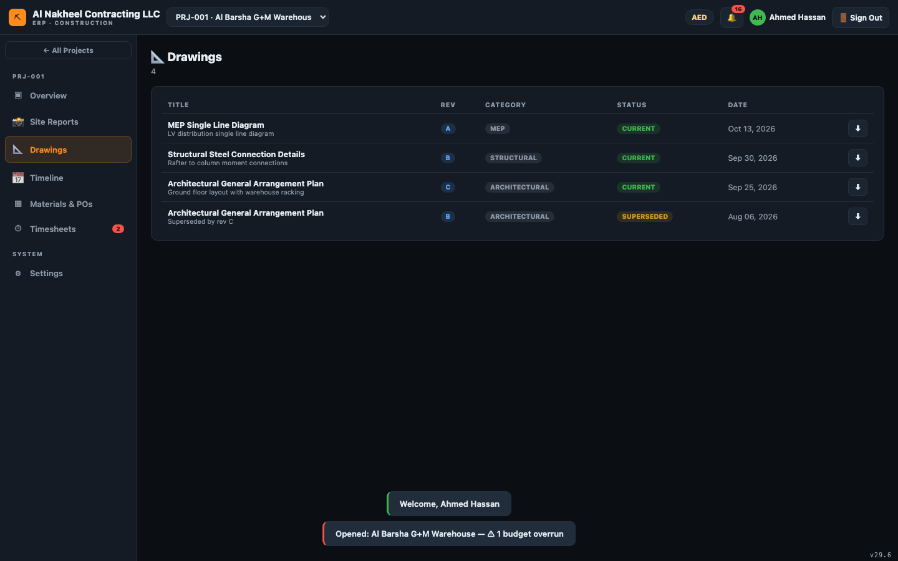
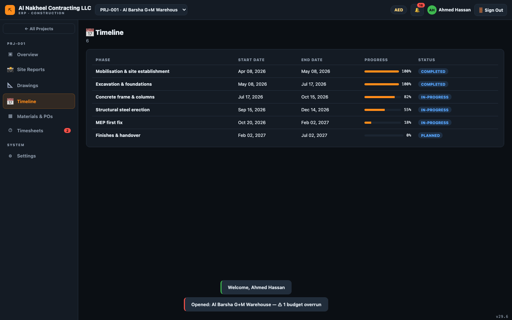
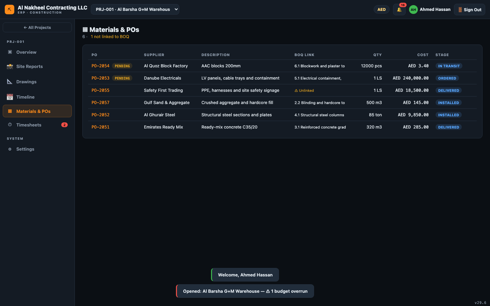
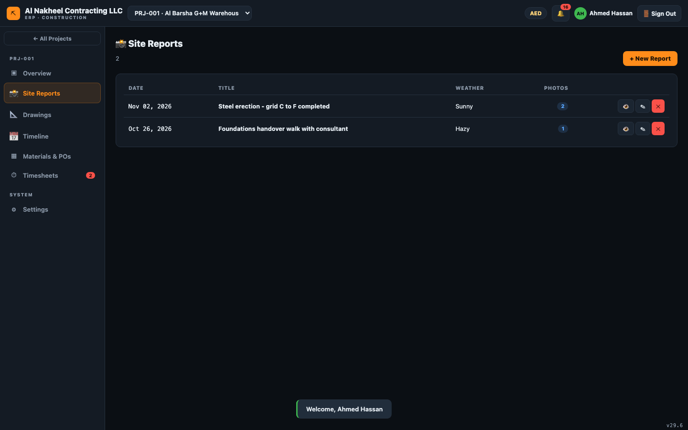

# Tradesperson Lead — Day Guide

The Tradesperson Lead has the **narrowest** access: you log your own work and view the information you
need on site. You cannot see the BOQ, approvals, finance, payroll or payment data.

**You can open:** Projects, and — inside a project — Overview, Drawings, Timeline, Materials/POs,
Timesheets, Settings, and Site Reports.

---

## 1. Start of day

1. Sign in → **Projects** list; pick your project from the top bar.
   
2. Open **Overview** to see the project snapshot.
   

## 2. Log your labour

1. **Timesheets** → **+ New** → choose your name (worker select), the BOQ/activity, date, regular and
   OT hours. Submitting marks it **pending** for a manager to approve.
   

## 3. Check drawings & schedule

1. **Drawings** — view the latest drawings/revisions.
   
2. **Timeline** — check today's and upcoming tasks.
   

## 4. Materials

1. **Materials** — view purchase orders and their stage (Ordered / In Transit / Delivered / Installed)
   so you know what material is expected on site.
   

## 5. Site report

1. **Site Reports** → **+ New Report** — record today's activities, issues and safety notes, and
   attach photos as evidence.
   

## 6. End of day

- Confirm your timesheet is submitted for the day.
- Submit the daily site report with photos.
- Note anything for tomorrow in the site report "Issues" field so the superintendent sees it.
